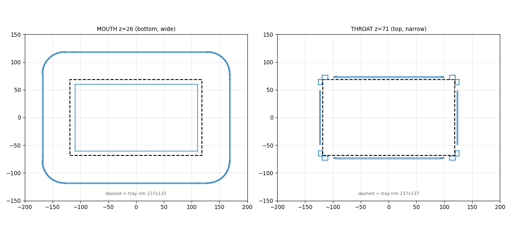
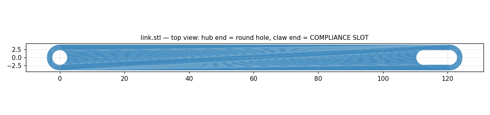
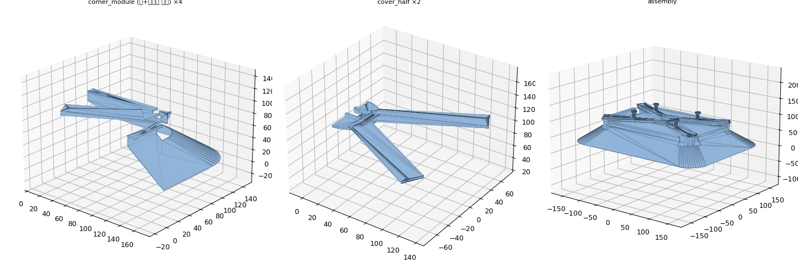
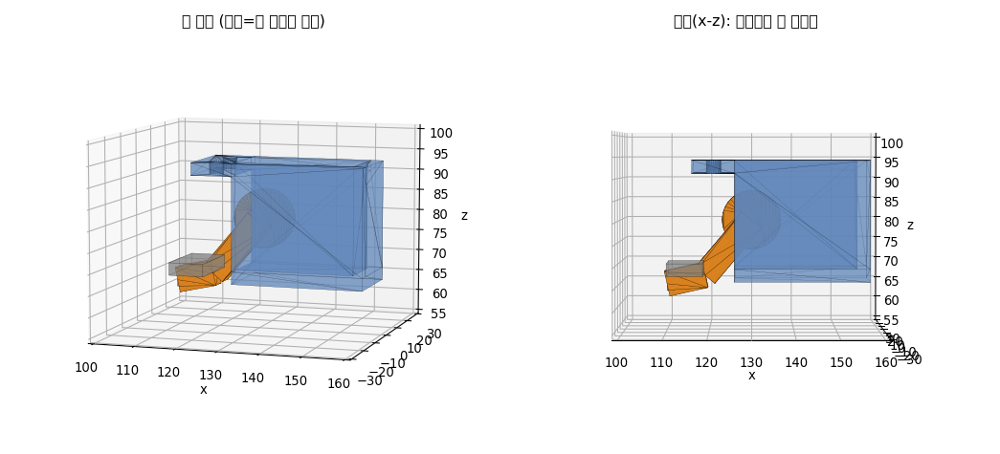

드론이 조난자 트레이를 집는 그리퍼를 설계했음. 5일 동안 v1부터 v22까지 고쳐 나갔고, 이 글은 그 과정의 기록임.

로봇항공기경연대회 VTOL 연재의 번외편이며, 소프트웨어 쪽 이야기([①편]()~④편)와는 따로 읽어도 됨.

## 트레이 형상

v1(7/23)은 트레이를 상자로 보고 사각 깔때기에 파지 기구 6종을 붙인 형태였음. 하지만 실물 치수를 받아 보니 트레이는 다리가 달린 격자판이었음. 테두리(림)는 237 × 137mm, 윗판은 220 × 120mm임. 림 아래에 8.5mm 파인 홈(언더컷)이 있어서 이곳을 집기로 했음.

드론은 트레이 위에 정확히 내려앉지 못함. 그래서 목표를 두 가지로 잡았음. 착륙 오차는 구조로 흡수하고, 발톱은 림 아래로 넣는 것임.

## v5~v14

7월 24일 하루에 v5부터 v14까지 만들었음(v8은 없음).

| 버전 | 아이디어 | 무게 |
|---|---|---:|
| v5 | 떠 있는 판 + 서보 1개로 스스로 정렬 | 약 97g |
| v6 | 모서리 ㄱ자 발톱 + 45° 코너 가이드(±100mm) | 약 173g |
| v7 | 단순 깔때기 + 수동 스냅 훅. "부품이 많으면 고장" | 약 154g |
| v9 | 서보 1개 + 링크 4개 + ㄱ자 발톱 4개 | 약 112g |
| v10 | 실제 3D 프린트용 부품(MG90S 서보) | 약 94g |
| v11 | ±90mm 가이드 | 약 149g |
| v12 | 이음매 없는 깔때기, 1.5mm 껍데기, 200mm 베드에 맞춰 분할 | 약 170g |
| v13 | 입구를 아래쪽으로 넓게. 착륙 오차를 입구에서 받아 위의 좁은 목으로 모음 | |

v5에서는 정렬이 어디까지 자유로워야 하는지 시뮬레이션으로 따져 보았음. 회전 자유도는 오히려 해로웠는데, 0°로 내려도 −6°가 생겼음. 그래서 자유도는 앞뒤와 좌우로만 ±8mm를 주었고, 필요한 유격은 착륙 오차 표준편차의 약 2.5배로 나왔음.

_v13 단면. 왼쪽이 넓은 아래 입구, 오른쪽이 좁은 위 목. 점선은 트레이 림(237 × 137mm)_

### v14 포획 시뮬

깔때기 모양을 다듬어도 포획이 잘 되지 않았음. 그래서 착륙 위치를 무작위로 뿌려 여러 번 굴리는 몬테카를로 시뮬레이션을 만들고, 어디서 막히는지 세어 보았음. 막힌 곳은 발톱이 림을 받아 줄 수 있는 폭(±3.2mm)이었음. 깔때기가 트레이를 잘 모아 와도 마지막 3mm에서 걸린 것임.

고친 것은 두 가지임. 우선 발톱 쪽 링크 구멍을 둥근 구멍에서 8mm 길이의 슬롯과 압축 스프링으로 바꿔, 발톱이 밀려나면서 스스로 위치를 맞추게 했음. 그리고 목 여유를 ±3.5에서 ±8mm로 넓혔음.

고치기 전에는 포획률 2%, 끼임 45%였음. 목 여유만 넓히면 오히려 1%로 떨어졌고, 발톱 슬롯까지 같이 넣자 포획 91%, 끼임 9%가 됨. 여기에 회전 베어링까지 더하면 97%였음. 이 결과에서 '발톱이 받는 폭 ≥ 목 여유 + 2mm'라는 규칙을 얻어 남겨 두었음.

_v14 링크 윗면. 서보 쪽은 둥근 구멍, 발톱 쪽은 슬롯_

## 기체 장착

그다음은 그리퍼를 기체에 다는 작업이었음. 이 단계에서는 무게와 프린터 크기가 계속 걸림돌이 되었음.

| 날짜 | 버전 | 바꾼 것 | 무게 |
|---|---|---|---:|
| 7/25 | v15 | 기체 장착 브래킷 + 서보 받침 | 약 163g |
| 7/25 | v16 | 부품 23 → 16개로 통합 | 약 161g |
| 7/26 | v17 | 깔때기를 ±11.6cm로 넓힘, 서보 MG946R | |
| 7/26 | v18 | 부품이 200mm 프린터 베드를 넘어서 ±8cm로 줄임 | |
| 7/26 | v19 | 실기체 마운트(150mm 사각 튜브)에 맞춤, 경량화 545 → 434g | 434g |

_v16 조립 형태. 모서리 모듈 4개, 덮개 2개_

## v20~v22 독립 훅

마지막에는 방향을 바꿨음. 서보 하나가 링크로 발톱 네 개를 움직이면 링크와 스프링, 슬라이드의 공차가 모두 쌓임. 그래서 4변에 각각 서보 훅을 따로 달았음.

서보는 SG90 4개를 쓰고 신호선은 하나로 병렬 연결했음. 스프링과 링크, 슬라이드가 없으니 맞춰야 할 공차도 0임. 훅을 열면 갈고리 끝이 위와 바깥으로 빠져서 림을 통과하고, 닫으면 림 아래 8.5mm 홈으로 들어가 트레이를 들어 올림. 서보 하나가 고장 나도 나머지 셋이 트레이를 잡음. 포획 시뮬레이션 결과는 98%, 무게는 약 395g임. 다만 트레이 방향을 카메라로 미리 맞춘다는 전제가 붙음.

v20을 확정본으로 정리한 것이 v22임.

_v20 훅 한 개. 파란 부분이 서보, 주황색이 갈고리_

이 그리퍼(시뮬레이션에서는 깔때기 형상)로 실제 트레이를 집는 파지 제어는 [①편]()에서 다룸.
