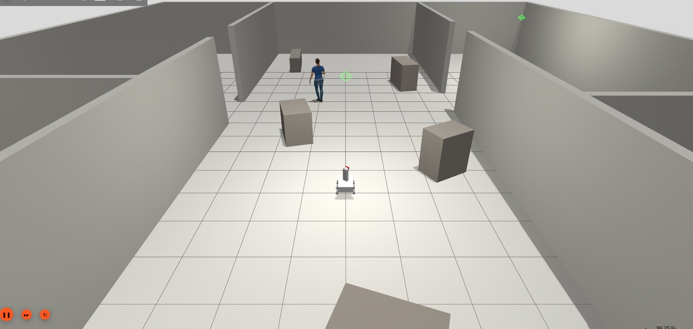

6륜 UGV가 재난 건물을 혼자 돌며 조난자를 찾아 상태를 분류(트리아지)하고, 열화상으로 화재 위치를 찍는 시뮬레이션을 만들고 있다. 환경은 ROS 2 Humble과 Gazebo Harmonic이다.
첫 주에는 Gazebo 버전을 옮기다가 로봇이 4.5m 공중으로 날아갔고, 조난자 위치는 2~3m씩 틀렸다. 이 글은 그 기록이다.

코드는 공개 레포 [iam-raccoon/ugv-rescue-robot](https://github.com/iam-raccoon/ugv-rescue-robot)에 있다.

## 로봇 구성

- 기체: 6륜 스키드 스티어, 2자유도 카메라 포탑
- 센서: 360° LiDAR, RGB-D 카메라, 열화상
- 주행: SLAM + Nav2
- 조난자: YOLOv8-pose 골격의 자세로 트리아지 (누움, 앉음, 서 있음)
- 화재: 열화상 blob과 depth로 위치 추정

LiDAR SLAM은 벽이 어디 있는지는 알려 주지만, 카메라가 그곳을 실제로 들여다봤는지는 알려 주지 않는다. 이 프로젝트는 주로 그 차이를 다룬다([②편]()).


_Gazebo Harmonic의 재난 건물 맵_

## Garden → Harmonic 이관

Gazebo Garden에서 만든 환경을 Harmonic으로 옮겼다. 바꿔야 하는 것은 두 가지다.

```xml
<plugin filename="gz-sim-velocity-control-system" name="gz::sim::systems::VelocityControl">
<gz_frame_id>${P}laser_frame</gz_frame_id>
```

플러그인 이름은 `ignition-gazebo-*-system`에서 `gz-sim-*-system`으로, 센서 태그는 `<ignition_frame_id>`에서 `<gz_frame_id>`로 바뀌었다. 문제는 맞는 파일이 없어도 에러가 나지 않는다는 점이다. 로드에 실패해도 로봇이 움직이지 않고 `odom`이 나오지 않을 뿐이다.

옮긴 뒤의 실측값은 `/scan` 9.8Hz, `/odom` 50Hz, 카메라 15Hz, 열화상 10Hz였고, 실시간 배율은 1.0이었다.

검출기도 이유 없이 느렸는데, 확인해 보니 PyTorch가 CPU 휠로 설치되어 있었다. 프레임당 104.5ms(9.6FPS)였던 처리 시간이 GPU 버전으로 바꾸자 9.2ms(108.9FPS)가 되었다.

## 로봇이 날아간 문제

로봇 몸통(base_link)만 중력을 끄고, 위에 얹힌 포탑과 총열(1.2kg)은 중력이 켜진 상태였다. 높이가 0.150, 0.128, 0.117m로 가라앉다가 튕겨서 z = 4.50m까지 올라갔고, 자세는 거의 거꾸로(roll 3.10rad)였다.

세 링크 모두 중력을 꺼 보았지만, 이번에는 땅에 닿는 순간 3.37m로 튀면서 뒹굴었다. 원인은 URDF의 `<kinematic>true</kinematic>`이 Harmonic에서 아무 경고 없이 무시된다는 점이었다. 결국 충돌체를 빼서 해결했다.

대신 충돌체가 없으니 경로 계획이 틀리면 로봇이 벽을 그대로 통과한다. 나중에 로봇이 건물 밖 34m까지 나간 일도 여기서 비롯되었다.

## 조난자 위치 오차

카메라 화면에서 사람을 찾으면 방위는 다음과 같이 계산한다.

```text
방위 = 로봇 방향 + 포탑 각도 + 화면 속 각도
```

처음에는 세 값을 그냥 더했다. 하지만 화면 x 좌표는 오른쪽이 +이고, ROS 각도는 왼쪽이 +다. 그래서 사람이 화면 중앙에서 벗어날수록 방위가 반대로 꺾였고, 위치가 2~3m씩 틀렸다.

```python
def bearing_from_pixel(cx: float, turret_yaw: float,
                       fov: float = _CAM_FOV, width: float = 640.0) -> float:
    return turret_yaw - (cx - width / 2.0) / width * fov
```

화각 상수도 같이 고쳤다. 실물 카메라 값(87°)이 들어가 있었는데, 시뮬레이션 카메라의 화각은 1.089rad(약 62.4°)였다.

정답 위치 (6, 1)에 있는 조난자를 기준으로 보면, 고치기 전에는 (4.1~4.7, −1.0~−1.4)로 찍혀 오차가 2.4~3.0m였다. 부호와 화각을 고치자 (5.8, 1.0)으로 찍혀 오차가 0.2m가 되었고, 1.5m 앞까지 다가가서 확인하면 0.14m까지 줄었다.

## 등록 규칙

위치를 등록할 때는 움직이면서 찍지 않도록 규칙을 정했다.

1. 정지 (0.05m/s 미만)
2. 포탑을 대상에 조준 (4° 이내)
3. 샘플 5개를 모아 중앙값으로 등록

## 화재 위치 오차

열화상에서 가장 뜨거운 픽셀의 거리로 화재 위치를 찍었더니, 정답 (12, 8.5)의 화재가 (3.9, 3.8)에 찍혔다. 화재 위치가 벽에 붙어 버린 것이다. 벽 필터를 붙여도 결과는 같았다.

원인은 두 카메라가 보는 거리의 차이였다. 열화상은 12m까지 보는데 깊이 카메라는 8m까지만 잰다. 그래서 8m 너머의 불은 깊이가 최대값(약 8m)으로 나오는데, 그 값을 그대로 믿고 있었다.

그래서 7.8m가 넘는 깊이는 버리고, 화재 인식 거리를 10m에서 7.5m로 줄였다. 깊이도 가장 뜨거운 한 점 대신 열 덩어리 전체 픽셀의 중앙값을 쓰고, 측정된 픽셀이 절반 이상일 때만 등록하도록 바꿨다.

고치기 전에는 화재 1곳에 4건이 등록되었고 오차가 약 10m였다. 거리 범위를 정리하자 1건, 오차 0.45m가 되었다. 여기에 멈추고 조준한 뒤 등록하는 규칙까지 넣으니 1건, 오차 0.72m였고, 반복했을 때의 산포는 0.01m였다.

## 다음

이제 대상을 제대로 보고 위치도 제대로 찍는다. 하지만 큰 건물에서 15분을 돌렸더니 조난자 0명, 화재 0건이었다. 지도는 다 그렸는데 아무것도 보지 못한 것이다. 이 문제는 [②편]()에서 다룬다.

## 연재 목록

1. Harmonic 이관과 위치 오차 (이 글)
2. [시각 커버리지와 트리아지]()
3. [로봇 2대와 카메라 각도]()
4. [로봇 3대와 Nav2 실패 루프]()
