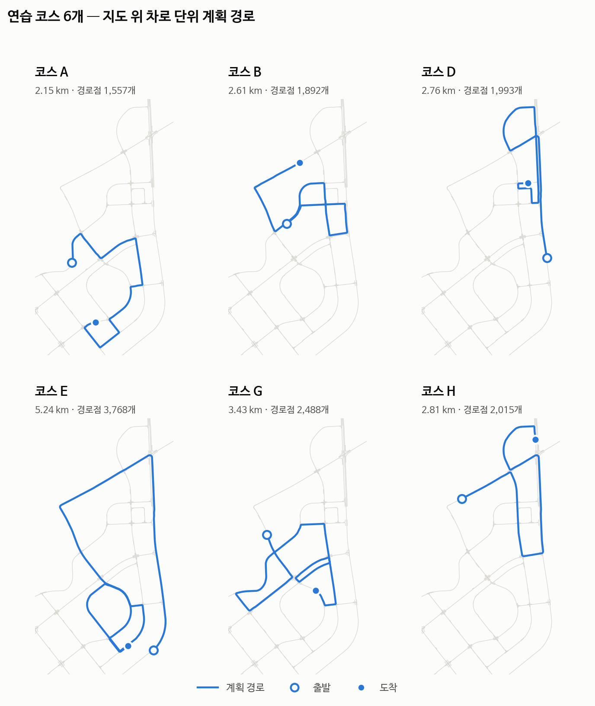
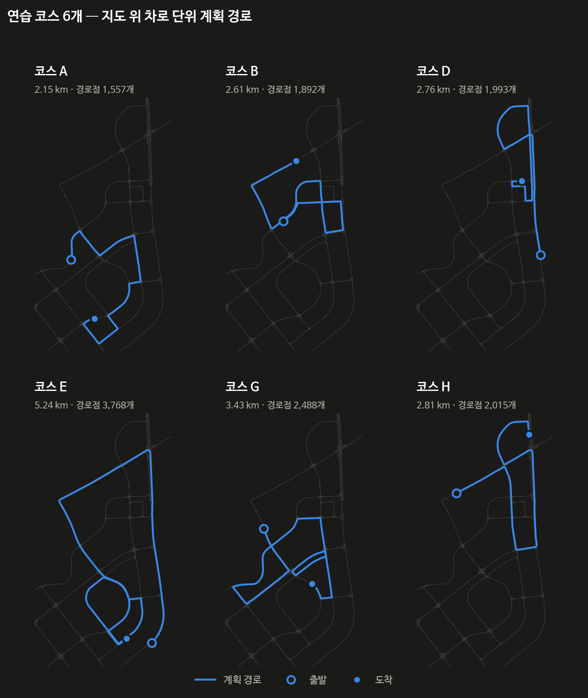

대회 당일 받는 정보는 출발, 교차로 진입과 진출, 종료 좌표 몇 개뿐임. 이 좌표를 OpenDRIVE 지도 위에서 차로 단위 경로로 바꾸고, 주행에 필요한 값을 경로점마다 미리 계산해 두었음. 이 글은 그 과정을 정리한 것임.

## 지도

이 맵은 OpenDRIVE의 `<speed>`도, 속도 표지판도 선언하지 않음. 쓸 수 있는 근거는 노면표시뿐이었음.

| 노면표시 | 개수 | 쓰는 곳 |
|---|---:|---|
| 직진 · 좌 · 우 화살표 (`RM_537_*`) | 458 · 144 · 134 | 차로 선택 |
| 직좌 · 직우 (`RM_538_*`) | 97 · 168 | 차로 선택 |
| 어린이보호구역 (`RM_536`) · 보호구역 속도 (`RM_518`) | 62 · 77 | 30km/h 구간 |
| 횡단보도 (`RM_532_*`) | 195 | 횡단보도 DB |
| 정지선 (`Rm_StopLine_300cm`) | 710 | 정지선 DB |

이 노면표시로 DB 세 개를 미리 만들었음. 신호 정지선 214개, 횡단보도 195곳(신호 121, 무신호 74), 신호와 짝이 없는 정지선 106개임.

신호 id는 xodr의 controller id에 해당함. signal id로 짝을 지으면 정지선이 500~1000m 어긋남.

## 차로 단위 최단경로

좌표 몇 개를 도로 단위로 이으면 어느 차로로 가야 좌회전 차로에 닿는지 알 수 없음. 그래서 차로를 노드로 둔 그래프를 직접 만들었음(Lanelet2의 RoutingGraph 방식을 OpenDRIVE 위에 옮긴 것).

```text
노드 = (road, lane, 그 도로에서의 차선변경 횟수) + 몇 번째 경유지까지 지났는지
간선 = xodr 이 명시한 lane link / junction laneLink   비용 = 도로 길이
     + 같은 도로 안 차선변경                          비용 = 활주로 기반
```

우선 몇 번째 경유지까지 지났는지를 노드에 넣어 경유지마다 층을 나누었음. 경유지 근처를 역방향으로 지나가는 지름길을 막기 위해서임.

차선변경 비용은 한 번 바꾸는 데 45m(30km/h로 5.4s)가 필요하다고 보고 정했음. `도로 길이 / 변경 횟수`가 짧을수록 비싸게 매기는 방식임. 168m 도로라면 세 번 모두 60이고, 30m 도로라면 90, 180, 240이 됨. 비용이 같으면 늦게 바꾸는 쪽을 고름.

노면 화살표 방향도 우선으로 반영했음. 화살표와 다른 방향으로 도는 차로에는 500m 페널티를 줌. 9경유지 시험 코스에서는 교차로 33곳 중 30곳의 화살표가 읽혔음.

처음에는 지정차로를 '경로를 옆으로 미는 오프셋'으로 처리했음. 이를 탐색 단계에서 지키도록 바꾸자 경로 길이는 3,488m에서 3,322m로, 지정차로 밖 경로점은 182개에서 0개로, 리스폰은 3번에서 0번으로 줄었음.



## 경로점 정보

주행 중에는 지도를 다시 뒤지지 않음. 경로를 만든 뒤 경로점마다 아래 값을 적어 둠.

- `lane` · `w`: 지금 차로, 차로 폭
- `l` · `r`: 같은 방향으로 왼쪽, 오른쪽에 남은 폭 (회피할 자리)
- `xl` · `xr`: 중앙선 너머까지 친 폭 (기본값은 미사용)
- `need`: 지정차로까지 옮겨야 할 횡방향 거리
- `j` · `jx`: 교차로 안인지, 진짜 교차로(갈래 3개 이상)인지
- `lim`: 제한속도
- `sig`: 지시등을 켜야 하는 구간

차선변경은 110m 전부터 45m 전까지(65m, 약 4.7s) 옮기도록 램프를 깔았음. 이 코스는 왼쪽 여유가 3.5m 이상인 곳이 45%뿐이고, 중앙선이 점선인 곳은 7%였음.

## 사전검사

경로를 만들면 `check_route`가 9가지를 검사함. 결과가 "이상 0곳"이 아니면 주행 스크립트가 출발을 거부함.

1. 헤딩이 60° 넘게 뒤집히는 곳
2. 경로점 간격 (5m 초과, 0.05m 미만)
3. 도로 밖
4. 역주행
5. 곡률 (조향 35°로 못 도는 곳)
6. 차로 점유 목록
7. 기준 경로와 대조 (이격 중앙값 1.6m 초과면 실패)
8. 교차로 안 차선변경
9. 노면 화살표 지시위반

## 시행착오

### 출발 방향

좌표만으로는 출발 방향을 알 수 없음. 코스 A에서는 경로의 44%를 가지 않았음. 경유지 직선 거리의 합은 1,098m인데 계획 경로는 5,278m였음. 차는 76.0°를 보고 서 있었는데 경로 시작 방향은 −106.1°로 정반대였음.

처음에는 최근접점을 찾는 함수의 문제라고 생각하고 고쳤지만 결과가 똑같았음. 원인을 잘못 짚은 것이었음. 그래서 시뮬레이터에서 차의 헤딩을 읽어 넘기도록 바꾸었음. 그래도 180° 틀리는 코스가 있어서, 결국 차의 현재 위치에서부터 경로를 계획하게 함(오차 0.1°).

```python
use = [ego_xy] + waypoints[1:]        # 첫 경유지는 차가 이미 그 자리에 있다
plan(mp, *use, heading=spawn_heading)
```

### 통신 주기 저하

한 시험 주행에서 25Hz이던 통신이 3.4Hz로 떨어졌음. 처음에는 시뮬레이터 문제로 보고 설정을 바꿔 가며 열세 번 실험했음.

원인은 경로 생성기였음. 생성한 경로가 전 구간에서 한 차로 바깥(3.20m)으로 나 있었고, 차는 연료통을 0.58m 간격으로 스치며 달리고 있었음. 경로점을 뽑는 함수가 계획한 차로 번호를 버리고 있었던 것임. 고친 뒤 이격은 3.20에서 0.42m로 줄었고, 그 주행은 131s에 완주했음. 사전검사 7번(기준 경로 대조)은 이 일 뒤에 추가함.

### 주최측 예시 CSV

형식 공지 날 받은 예시 경로를 넣었더니 경로가 나오지 않았음. 원인 세 가지가 겹쳐 있었음. 좌표로 찾은 차로 번호와 그래프 노드 번호 체계가 달랐고(한 도로가 구간 9개로 쪼개진 곳), 중간에 사라지는 차로에는 다음 간선이 없었음. 한 도로에서 차선변경이 두 번 필요한 곳도 그리지 못했음.

고친 뒤에는 592점, 821m, 이상 0곳이 나왔음. 다른 코스들도 짧아졌음(3,604m에서 2,613m로).

### 되돌린 것

좋아 보였지만 되돌린 변경도 있음. 화살표 페널티를 500에서 3000으로 올리자 경로가 5,242m에서 6,114m로 돌아가기만 했음. 연결로에 직행 간선을 넣었을 때는 코스 E가 5,242m에서 2,145m로 줄었지만, 실제로는 갈 수 없는 지름길이었음. 둘 다 바로 되돌렸음.

## 한계

9개 경로 중 4곳에서 좌회전 차로를 잡지 못함. 3곳은 그 회전을 허용하는 차로가 지도에 아예 없는 지도 모순이고, 1곳은 차로 번호가 중간에 한 칸 밀리는 구간(폭 0.47m짜리 `none` 차로) 때문에 생긴 라우터 버그임. 고치려면 노드 식별자를 바꾸고 전 코스를 다시 검증해야 해서 대회 뒤로 미루었음.

{: .light }
{: .dark }
_연습 코스 6개. 좌표는 대회 형식대로 직접 골랐고 경로는 당일과 같은 절차로 만들었음_

← [①편]() · [③편]() →
