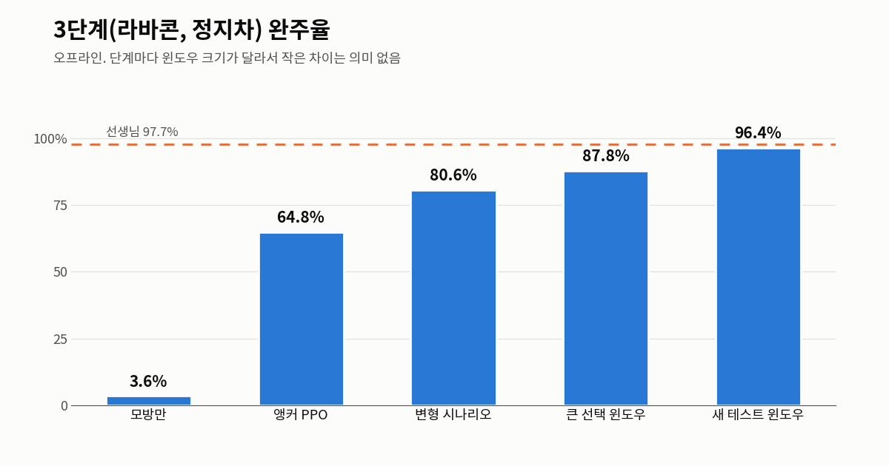
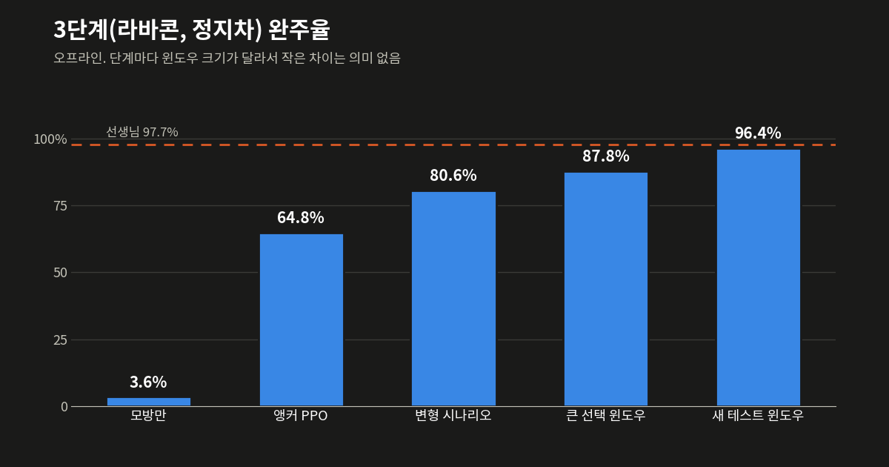

3단계에서 학습이 막혔다. 3단계는 신호에 더해 라바콘과 정지차가 길을 막는 단계다. 선생님은 18번 중 18번을 완주했지만 학생은 한 번도 완주하지 못했고, 매번 첫 장애물에 그대로 부딪혔다. 이 글의 숫자는 모두 오프라인 환경에서 잰 값이다(VTD 결과는 ⑤편부터 다룬다).

## 관측 확인

처음에는 학생이 장애물을 보지 못한다고 생각했다. 그래서 관측부터 확인했는데, 물체가 관측에서 빠진 스텝도 없고 없는 물체가 들어온 스텝도 없었다. 물체는 80m 앞(78.7~80m)부터 정상으로 들어오고 있었다.

문제는 그다음이었다. 물체가 25.6m에서 4.3m까지 다가오는 동안 학생은 조향과 가속을 0.01 이하로만 움직이며 13.32m/s(약 48km/h)를 그대로 유지했다. 같은 에피소드에서 선생님은 브레이크를 끝까지(−1.0), 핸들도 끝까지(1.0) 썼다. 학생은 장애물을 보고도 반응하지 않은 것이다. 그래서 관측은 그대로 두고 학습 데이터를 고치기로 했다.

## 망각 문제

장애물 장면을 모아 모방 학습을 더 시키자 이번에는 1단계(빈 길) 완주가 0%로 떨어졌다. 학습률을 3e-6까지 낮춰도 결과는 같았다.

그래서 가중치가 얼마나 움직였는지와 어느 방향으로 움직였는지를 나눠서 보았다. 같은 크기(Δθ ≈ 0.54)만큼 무작위 방향으로 움직이면 1단계 완주가 83.3%였고, 3단계 데이터 방향으로 움직이면 0%였다. 학습률을 낮춰도 소용없었던 이유는 움직인 방향에 있었다. 손실에 원래 하던 행동을 유지하라는 항이 없으니, 3단계 데이터 쪽으로 가면서 빈 길 운전을 지워 버린 것이다.

## KL 앵커

학습 손실에 얼려 둔 출발 정책과의 KL을 더했다. 순방향 KL(`KL(ref ‖ net)`)은 출발 정책이 하던 행동을 새 정책도 해야 손실이 작아지므로 망각을 막는 쪽으로 작용한다.

1에포크만 돌려 비교하면 앵커 계수가 0일 때 1단계 완주는 0%(가중치 이동 Δθ 4.44), 계수가 10일 때는 100%(Δθ 1.10)였다. 여기에 정지차 앞 30m 안의 샘플에 손실을 4배로 주자 정지차 장면 완주가 15.8%에서 60.8%로 올랐다(시드 5개 모두).

## 학습마다 결과가 다름

비슷한 설정에서도 어떤 학습은 정지차를 넘고 어떤 학습은 넘지 못했다. 원본 체크포인트를 가중치까지 똑같이 재현한 뒤, 데이터와 갱신 횟수, 배치 순서를 하나씩 바꿔 가며 네트워크 60개를 다시 학습했다. 학습 한 번이 정지차를 넘을 확률은 40% 정도였고, 그 차이를 가른 것은 배치 순서였다. 그 뒤로는 시드를 여러 개 돌려서 골랐다.

모방 학습으로 갈 수 있는 곳은 여기까지였다. 라바콘 장면은 74.7%, 정지차 장면은 65.8%까지 올랐지만, 둘이 섞인 3단계 전체(장애물 25개)는 3.6%에 그쳤다.

## PPO에도 앵커

PPO는 직접 부딪혀 보며 배우기 때문에 모방 학습이 넘지 못한 장면을 넘을 수 있다. 하지만 ②편에서 본 것처럼 PPO는 잘하던 행동도 망가뜨린다. 그래서 PPO 미니배치마다 같은 KL 앵커를 걸었다.

```python
# vtd_rl/rl/ppo.py (PPO 미니배치마다 얼려 둔 출발 정책과의 KL을 더함)
parts["anchor"] = 0.0
if cfg.anchor_coef > 0.0:
    anc = anchor_loss(net, batch, ref)
    loss = loss + cfg.anchor_coef * anc
    parts["anchor"] = float(anc.item())
opt.zero_grad(set_to_none=True)
loss.backward()
nn.utils.clip_grad_norm_(net.parameters(), cfg.max_grad_norm)
opt.step()
net.clamp_log_std()
```

정지차 장면 완주(선택 윈도우)를 보면 출발점인 모방 정책이 68.5%였고, 앵커 없는 PPO는 오히려 48.1%로 떨어졌다. 앵커 0.03을 건 PPO는 97.2%였다.

## 3단계 전체 결과

같은 방식을 3단계 전체로 넓혔다. 액터 위치를 흔든 변형 시나리오를 섞어서 학습했고, 학습과 모델 선택에 쓰지 않은 새 테스트 윈도우로 결과를 쟀다.

{: .light }
{: .dark }
_모방 학습만 했을 때 3.6%에서 새 테스트 윈도우 96.4%까지. 점선은 선생님이다_

| 단계 | 3단계 완주 |
|---|---:|
| 모방만 | 3.6% |
| 앵커 PPO, 3단계 전체 | 64.8% |
| 변형 시나리오 섞기 | 80.6% |
| 큰 선택 윈도우로 고르기 | 87.8% |
| 새 테스트 윈도우 | 96.4% |

중간에 걸린 문제가 하나 있었다. 72에피소드짜리 선택 윈도우로는 상위 네트워크를 가려낼 수 없었다. 네트워크 12개의 순위를 72에피소드와 384에피소드로 비교해 보니 스피어만 상관이 0.17로, 사실상 무작위였다. 그 뒤로는 384에피소드 윈도우로 고르고, 따로 떼어 둔 새 테스트 윈도우로 확인했다. 위 표도 윈도우 크기가 섞여 있어서 칸 사이의 작은 차이에는 의미를 두지 않았다.

완주율은 선생님을 거의 따라잡았다. 하지만 완주한 에피소드의 점수를 보면 학생은 아직 신호와 차로에서 많이 감점되고 있었다. 이 문제는 [④편]()에서 다룬다.

← [②편]() · [④편]() →
