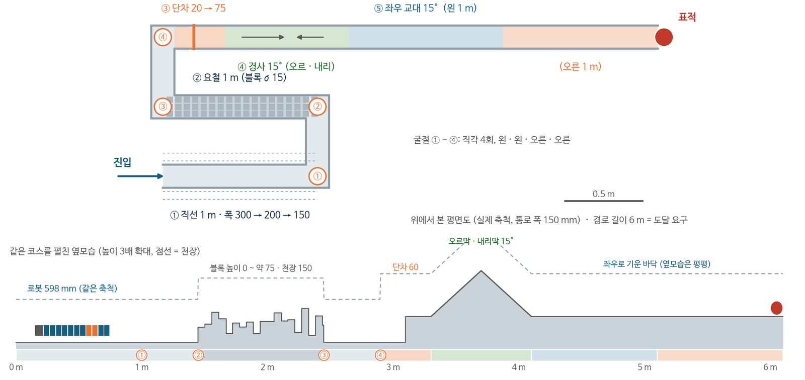
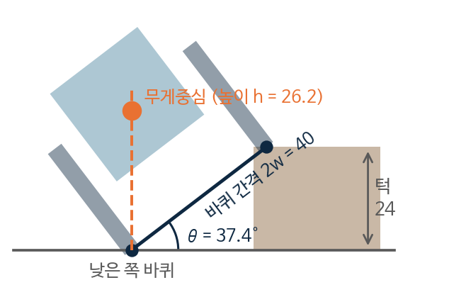
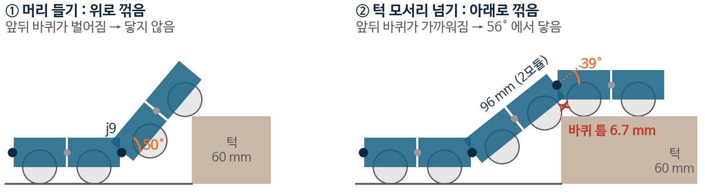

지난 과제의 공통 지적은 시나리오를 로봇에 맞추지 말고 재난 상황에서 근거를 대라는 것이었다. 그래서 이번 과제(기본 형상 I)는 거의 처음부터 다시 했다.

순서는 환경, 요구, 시험 조건, 설계로 고정했다. 이 순서를 어기면 로봇이 할 수 있는 만큼을 요구로 적는 역산이 된다. ③편의 통로 치수가 바로 그런 경우였다.

## 시나리오

시나리오는 철근콘크리트 공동주택의 팬케이크 붕괴로 잡았다. 층 슬래브가 차례로 내려앉아 겹치면 슬래브 사이에 얇고 굽은 공극이 생긴다. 구조대가 진입구를 열면 로봇이 들어가 3~5m 안쪽을 본다. 구마모토 2016 때 경찰이 구조한 60명 중 72%가 진입점 4m 이내에 있었다.

지금 장비가 닿는 범위는 이 정도다. 삼풍 1995 때는 내시경 카메라로 작은 틈 62곳을 탐사했다. 현행 영상탐지기는 직선 폴로 1,590mm까지 닿고, 구동이 없는 비디오 스코프는 약 1m까지다. 선례로 로봇 내시경 ASC가 있는데, 자주식으로 7m(3cm 틈)까지 들어가지만 2인이 조작해야 한다. 목표는 굽은 경로 3~5m를 1인 조작으로 들어가는 것이다.

## 시험 조건

| 항목 | 요구 (환경 근거) | 시험 조건 | 근거 |
|---|---|---|---|
| 통로 | 폭 300mm 공극 통과 | 폭 300 → 200 → 150, 높이 100 | 멕시코시티와 삼풍 진입 틈 30cm, 삼풍 틈 높이 10cm |
| 굴절 | 직각 굴절 | 직각 4회 (반대 방향 2번) | 붕괴 가옥 모사 시험 경로 (Tadokoro 외 2009) |
| 단차 | 문턱 20mm (필수), 욕실 턱 60mm (목표) | 20 → 40 → 60 → 75, 각 5회 연속 | 국내 아파트 10세대 실측 (이특구, 이호성 2009) |
| 요철 | 몸길이 요철 13mm | 블록 지형 σ 5 → 23, 인수 σ15 | 2015 네팔 지진 잔해 LiDAR 공개 데이터 자체 분석 |
| 경사 | 오르막, 내리막, 횡경사 15° | 0°부터 5° 간격 | NIST 시험장 15° 램프, 잔해 스캔 몸길이 기울기 10~14° |
| 도달 | 6m 이상 | 경로 6m | Rao 2022 (Champlain 공극) |

시험은 요구값을 넘는 단계까지 올려서 한계를 확인한다. NIST 방식대로 실패할 때까지 올리고, 마지막으로 5회 연속 성공한 단계를 기록한다.

_시험로 한 코스 (실제 축척 평면도와 펼친 옆모습)_

지난 과제에서 범위를 '평탄한 공극만'으로 좁혔던 결정은 여기서 뒤집었다. 재난 로봇이 경사와 험지에 약하면 안 된다는 지적이 있었고, 실제 잔해 스캔을 봐도 같은 결론이었다. 이 때문에 생긴 문제는 [⑤편]()의 오르막과 요철 절에서 다룬다.

## 조작 입력

기존 뱀 로봇은 구조대원이 조작하지 못해서 연구원이 직접 조작했다(멕시코시티 2017, 조작 인원 2:1). 이 과제는 입력을 전후 속도와 조향 2개로 줄이고, 관절 10개의 동작은 로봇이 만든다.

고정 동작은 지형이 바뀌면 실패한다. 손으로 고른 진폭은 경사가 바뀌면 2배 느려지거나 굴러떨어졌다(Gong 외 2014). 그래서 접촉 감지(M1)와 학습 제어(M2, 2학기)로 가기로 했다.

## 관절 배치

피치가 필요한지, 피치 간격은 얼마인지를 먼저 정하고 남는 관절은 요로 두었다.

우선 바퀴 굴림만으로는 바퀴 지름 1/3을 넘는 턱을 넘지 못하므로, 관절로 몸을 들어야 한다. 피치 사이에는 조향과 추진용 요가 있어야 하므로 가장 촘촘한 피치 간격은 2모듈이다. 그래서 피치 5(j1, 3, 5, 7, 9)와 요 5(j2, 4, 6, 8, 10)를 번갈아 두었다. 턱을 넘은 선행 뱀 로봇 ACM-R3, R4도 모두 1:1 교대 배치다.

지난 과제 안(HW#3 안, 요 7 + 머리 피치 2)과는 MuJoCo로 비교했다. 조건은 통로 150 × 100, 구동 바퀴 2모듈, 같은 제어기로 맞췄다.

20mm 턱에서 HW#3 안은 0/8, 교대 5 + 5는 10/10이었다. 테더와 마찰을 바꿔 3가지로 돌린 34mm 턱에서는 0/24 대 30/30이었다. HW#3 안은 머리 1~2마디만 오르고 몸통이 걸렸고, 교대 배치는 걸리는 곳이 없었다.



몸통에 피치가 없으면 몸통이 턱에 걸린다. 제어로는 풀 수 없고 배치를 바꿔야 하는 문제였다.

## 접지 반폭

바퀴를 몸 중심에서 얼마나 떨어뜨릴지(접지 반폭 w)는 두 조건 사이에서 정했다. 넓을수록 넘어지지 않지만, 파동을 칠 때 차지하는 폭이 통로 150mm를 넘으면 안 된다.

{: w="420" }
_한쪽 바퀴만 턱에 오를 때. tan θ = w / h, 버티는 턱 = 2w · sin θ_

버티는 턱은 20mm 이상, 차지하는 폭은 150mm 이하여야 한다. w가 15mm면 버티는 턱이 15mm라 모자란다(차지하는 폭 131mm). w가 25mm면 턱은 35mm로 넉넉하지만 폭이 151mm라 통로를 넘는다. 그래서 w 20mm(버티는 턱 24mm, 폭 141mm)를 채택했다.

## 단차 넘기

_머리를 들 때는 위로 꺾여 바퀴가 벌어지고, 모서리를 넘을 때는 아래로 꺾여 앞뒤 바퀴가 가까워진다_

앞부분 전체를 관절 하나로 들면 j3은 0.54N·m(스톨의 105%), j1은 0.83N·m가 필요해서 들 수 없다. 그래서 관절을 차례로 들게 했다. 앞부분을 먼저 턱에 올리고 뒤쪽 관절을 하나씩 들면, 각 관절은 바로 앞 2모듈만 들면 된다. 이때 필요한 토크는 최대 0.043N·m(스톨의 8%)다. Tanaka 외(T-RO 2015)도 같은 순서를 썼다.

## 구동 바퀴

턱은 몸으로 넘고, 구동 바퀴는 뒤에서 밀어 준다. 수동 바퀴만으로는 테더 끌림이 클 때 미는 힘이 모자란다. 그래서 머리를 들 때도 바닥에 남는 자리(머리 들기 관절 바로 뒤, 7·8번 모듈)에 구동 바퀴를 달았다. 모터 두 개의 자리는 시험 두 번으로 골랐다. 1차는 34mm 턱 4회씩, 2차는 턱 20~40mm, 테더, 마찰, 위치 오차를 섞은 14조건 × 10회였다.

이렇게 나온 기본 형상은 전장 598mm(본체 528 + 꼬리 70), 단면 44 × 41mm, 접지 반폭 ±20mm, 질량 384g이다. 모터는 관절 10개와 바퀴 2개다.

## 받은 피드백

- 복귀를 고려하지 않았다. 거꾸로 달릴 수 있어야 하고, 갈 때의 조건을 올 때도 똑같이 줘야 한다
- 실제로는 홀이 여러 개다. 돌아올 길을 찾는 방법은 이론으로 설계에 넣고, 시험은 홀 하나로 해도 된다
- GNSS 없이 위치를 어떻게 아는지. IMU만 쓰면 바이어스와 드리프트로 시간이 지날수록 위치 오차가 커지니 직접 계산해서 판단할 것. 다른 센서는 부피가 커지는 문제가 있다
- 실제 형상은 3차원이다. 90°나 예각으로 꺾여 올라가는 곳에서 되는 조건을 이론으로 먼저 세우고, 시험은 2차원으로 줄였을 때의 성능이라고 밝힐 것
- 시뮬레이션을 어떻게 돌렸고 무엇이 달라서 새 안이 낫다고 판단했는지 보일 것
- 피치 서보로 몸을 들고 구동 바퀴로 자동차처럼 가면 되지, 굳이 요 관절로 뱀처럼 움직일 필요가 있는지
- 기존 뱀 로봇의 조종 입력이 몇 개인지 보이고, 조작이 어려운 건지 구조의 한계인지 구분해서 내 조종과 비교할 것
- 카메라만으로는 판단이 어렵다. 마이크를 머리, 몸 중간, 꼬리에 어레이로 두어 소리 방향을 잡는 안처럼 IMU, 영상, 음성을 묶은 복합 센서를 볼 것
- 후진 때문에 시스템이 너무 복잡해지면 당분간 테더로 당겨 빼는 개념을 유지하고, 차체는 단순하게 둔 채 센서 쪽에 집중할 것
- 가장 중요한 구조는 관절이다. 피치, 롤, 요마다 간섭 없이 쓸 수 있는 범위를 형상에서 정할 것. 많이 든다고 꼭 좋은 것은 아니고, 롤이 전혀 없으면 하나가 넘어갈 때 전체가 넘어간다
- 실제 재난 현장에서 뱀 로봇이 쓰이는지, 통신은 원활하게 유지되는지 질문이 있었고, 조작을 쉽게 하고 효율적인 동작을 학습시킨다는 최종 목표가 발표에 더 드러나야 한다는 말도 들었다

다음 과제는 이 중 관절 간섭부터 시작했다.

다음 글: [⑤ 기본 형상 II]()
