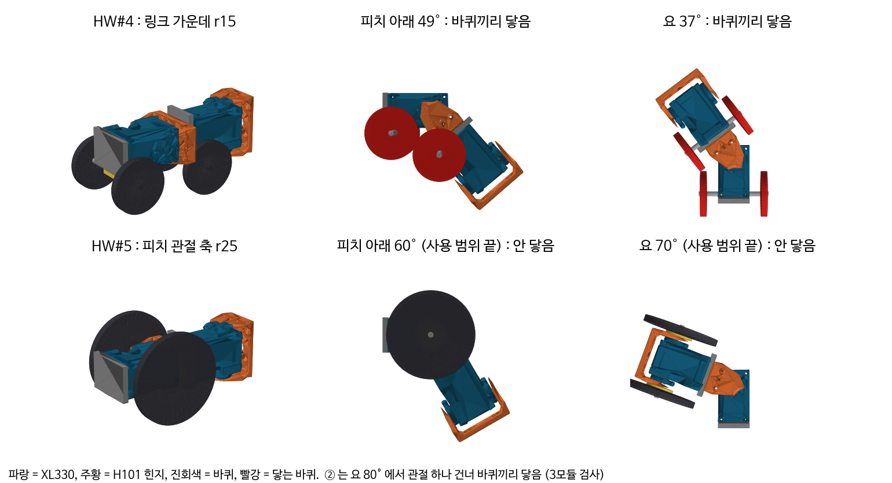
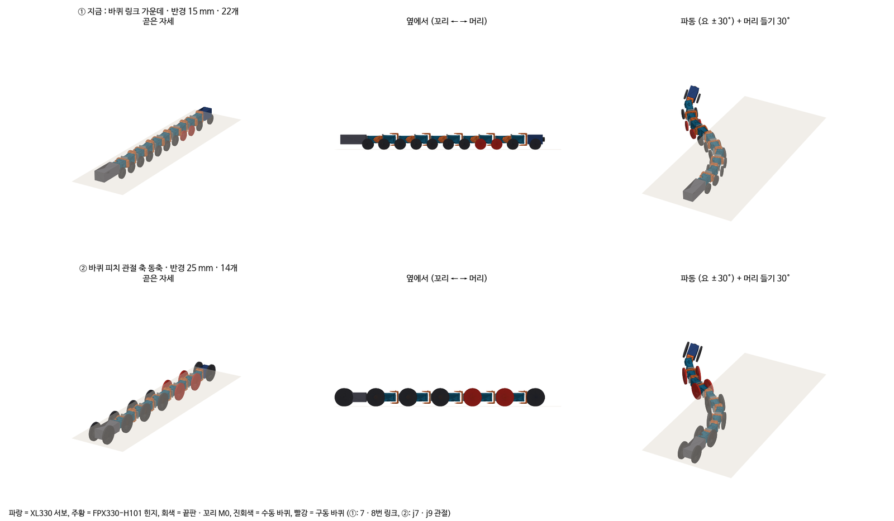
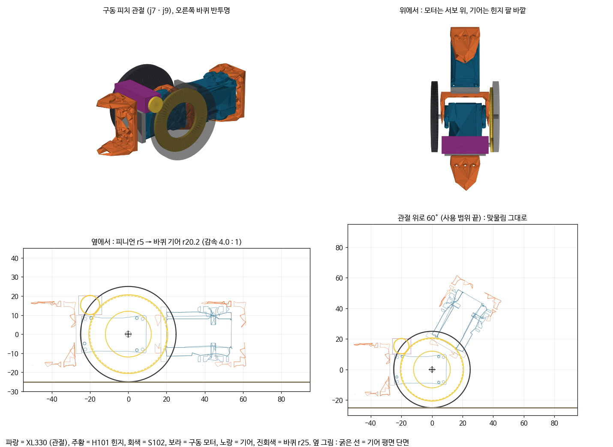

HW#4에서 "관절마다 간섭이 생긴다, 피치, 롤, 요 각각 얼마까지?"라는 피드백을 받았다. 이 글은 그 답을 찾은 기록이다. 답을 찾다 보니 바퀴 위치와 꼬리 상자까지 바뀌었다.

## 간섭 검사

HW#4 형상(바퀴가 링크 가운데, r15)을 실제 부품 STEP 파일(XL330 서보, FPX330 힌지)로 조립했다. 그리고 1°씩 꺾어 가며 충돌 검사(trimesh + fcl)를 돌렸다.

_위는 HW#4 배치로, 피치 아래 49°, 요 37°에서 바퀴끼리 닿는다. 아래는 피치 관절 동축 바퀴로, 사용 범위 끝에서도 닿지 않는다_

피치를 아래로 49° 꺾으면 앞뒤 바퀴가 닿는다. 60mm 턱 모서리를 넘을 때 필요한 각과 비슷한 값이다. 요는 37°에서 닿는데, 파동 30°에 조향을 더하면 금방 넘는 각이다.

## 바퀴 배치

그래서 바퀴를 피치 관절(j1, 3, 5, 7, 9)의 회전축과 같은 축에 달았다. 이렇게 하면 관절을 아무리 꺾어도 바퀴는 자기 축 둘레로 돌기만 하고 모양이 변하지 않는다. 피치 쪽에서는 바퀴끼리 닿는 문제가 사라졌다.

_① 링크 가운데 r15 × 22, ② 피치 관절 동축(여기서는 r25, 이후 r28로 변경). 빨강은 구동 바퀴_

모듈 길이와 단면, 꼬리 상자를 도면 치수로 맞춘 뒤 ①과 ②를 다시 비교했다. 단차 14조건(턱 20~40mm, 테더, 마찰, 턱 위치 추정 오차를 바꿔 10회씩)에서 ①은 137/140, ②는 140/140이었다. 60mm 턱(천장 150)에서는 ①이 9/10, ②가 10/10이었다. ②가 모든 시험에서 ①과 같거나 나았다.

## 관절 사용 범위

| 관절 | 하는 일 | 필요 (계산) | 간섭 한계 (실제 부품) | 사용 범위 |
|---|---|---|---|---|
| 피치 | 머리 들기, 턱 모서리, 몸 따라 들기 | 모서리 42°, 머리 들기 56~64° | 프레임 110°, 구동 모터 위 90° | ±60° |
| 요 | 파동 + 조향 | 30° + 조향 28.6° = 58.6° | 관절 하나 건너 바퀴끼리 (r28에서 71°) | ±65° |
| 롤 | - | - | - | 없음 (고정) |

피치 ±60°는 다음과 같이 정했다. 피치 범위를 묶어 놓고 단차 시험을 다시 돌려 보니 ±45°까지 줄여도 60mm를 넘었다. 머리 받침 바퀴가 턱 면에 밀려서 굴러 넘은 것이다. 묶지 않은 ±90°는 14조건 140/140, 60mm 10/10이었고, ±60°도 140/140, 10/10으로 같았다. ±45°는 가혹 조건만 돌려서 30/30, 60mm 10/10이었다.

하지만 시뮬레이션 밖의 오차(턱 모서리 모양, 마찰)가 있으므로 기하로 계산한 필요각까지 덮는 ±60°로 정했다. "많이 드는 게 꼭 좋은 건 아니다"라는 피드백에 대한 답이기도 하다.

롤은 고정했다. 관절 자리에 수동 롤(스토퍼 ±15, 30°, 스프링)을 넣어 비교해 보았는데 결과가 엇갈렸다. 한쪽만 올라간 경사로에서는 단단하게 제한한 롤이 나을 때가 있었다. 하지만 완전 자유 롤은 거의 매번 뒤집혔다(링크 가운데 바퀴 배치에서 24/24). 이후 요철 시험에 제한 롤(±15°)을 넣었을 때도 4번 모두 뒤집혔다. 이득이 분명하지 않아서 만들기 쉬운 롤 고정을 택했다.

요 간섭 한계는 처음에 잘못 적었다. 첫 간섭 검사는 관절 하나 양쪽의 두 모듈만 봐서 요 한계를 110°로 적었다. 관절 하나 건너 바퀴끼리(피치 A, 요 B, 피치 C의 3모듈) 닿는 경우를 놓친 것이다. 3모듈로 다시 검사하니 한계는 80°(r25)였다.

## 구동 바퀴 모터

구동 바퀴도 관절 축(j7, j9)에 있다. 관절 서보는 관절을 돌리는 데 쓰이므로 바퀴를 돌릴 모터가 따로 필요하다. 그리고 그 모터가 관절 꺾임을 막아서는 안 된다.

_소형 기어드 모터(N20 급)를 서보 위에 눕혀 바퀴 안쪽 기어(중심 = 관절 축)에 물린 구조. 감속 4:1, 관절을 60° 꺾어도 맞물림 거리는 그대로_

기어 중심이 관절 축이라 관절을 몇 도 꺾든 맞물림이 유지된다. 모터 윗면(+20.3mm)이 바퀴 윗끝보다 아래에 있어서 높이도 늘지 않는다. 필요 토크는 바퀴당 0.004N·m 정도라 N20 급이면 여유가 있다.

## 꼬리 상자 M0

꼬리에는 제어기와 강압기가 든 상자(M0, 70mm, 30g)가 붙는다. 처음에는 고정 상자였는데 문제가 두 가지 나왔다.

우선 좌우로 꺾이지 않으면 굴절이 막힌다. 위아래로만 꺾이는 M0로는 ①이 굴절 0/6이었고, 좌우 힌지를 더하자 6/6이 되었다.

하지만 좌우 힌지가 자유로우면 후진할 때 접힌다. 자동차 트레일러를 후진할 때와 같은 현상이다. 직선 후진 10s 동안 8~17cm밖에 가지 못했다.

| M0 좌우 힌지 | 직선 후진 10s | 굴절 뒤 복귀 |
|---|---|---|
| 자유 | 8~17cm | 4/4 |
| 후진 때만 서보로 곧게 | 102~154cm | 4/4 |
| 좌우 고정 | 140~167cm (대신 전진 지형 성능이 나빠짐) | 4/4 |
| 자유 + 지상 릴이 테더를 0.2N으로 당김 | 119~144cm | 4/4 |

릴은 복귀 개념(긴 복귀 때 테더 자동 회수)에 이미 들어 있어서 부품이 늘지 않는다. 그래서 좌우 힌지는 자유로 두고 후진할 때 릴 장력을 주기로 했다. 바퀴는 힌지 바로 뒤에 둬야 60mm를 넘었다(상자 가운데에 두면 0/10). 결국 꼬리 제어기 상자(M0)는 좌우로 꺾이는 트레일러가 되었다.

이 트레일러의 위아래 힌지는 처음에는 자유였다. 이 힌지가 복귀할 때 문제가 된 일은 [⑦편]()에서 다룬다.

다음 글: [⑥ 오르막과 요철]()
