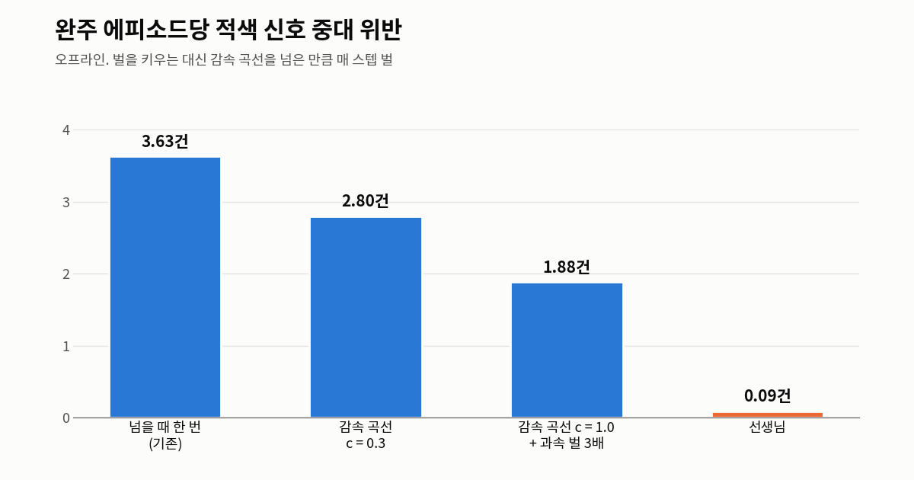
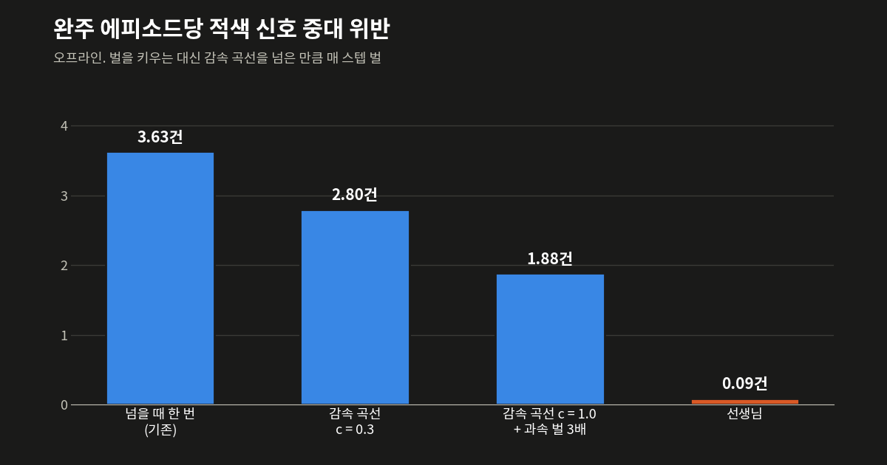

③편에서 완주율은 선생님을 거의 따라잡았지만, 완주한 에피소드의 점수를 보면 학생은 아직 신호와 차로에서 많이 감점되고 있었다. 이 글은 그 감점을 줄인 기록이다. 이 글의 숫자도 모두 오프라인 환경에서 잰 값이다.

## 문제

완주 에피소드당 중대 위반은 적색 신호에서 학생 3.63건(선생님 0.09건), 차로 유지에서 학생 3.33건(선생님 0.40건)이었다.

## 벌 키우기

처음에는 적색 위반 벌을 5배, 10배로 키워 보았다. 그렇게 학습한 체크포인트 36개 모두 적색 중대가 3.24~3.70건으로 그대로였다.

원인은 벌이 들어오는 방식에 있었다. 채점기의 적색 벌은 정지선을 넘는 순간 한 번 들어온다. 끝까지 서 본 적 없는 정책은 조금 늦게 지나가든 빨리 지나가든 같은 벌을 받는다. 덜 위반하는 쪽으로 가는 기울기가 0이라, 벌을 키워도 0에 곱하는 셈이었다.

## 감속 곡선 벌

정지선 앞 1m에 서려면 지금 거리에서 얼마나 느려야 하는지는 등감속 식으로 바로 나온다. 그 속도를 넘은 만큼 매 스텝 벌을 주었다. 이렇게 하면 조금이라도 덜 빠를 때 벌이 줄어든다.

```python
# vtd_rl/env/reward.py — 적색 감속 곡선
def red_excess(red, decel: float) -> float:
    """적색 접근 (gap, v) → 감속 곡선을 넘은 속도[m/s]. red 가 None(적색 아님)이면 0.

    gap 은 앞범퍼에서 정지선까지[m](앞이 +). 허용 속도 v_ok = sqrt(2·decel·max(gap−1, 0))
    는 정지선 앞 1 m 에 서는 등감속 곡선이다. 채점기가 '넘었다' 고 보는 −1 m 너머는 ⑦ 이 맡으므로 0.
    """
    if red is None:
        return 0.0
    gap, v = red
    if gap < -1.0:
        return 0.0
    v_ok = math.sqrt(2.0 * decel * max(gap - RED_STOP_TARGET, 0.0))
    return max(0.0, float(v) - v_ok)
```

{: .light }
{: .dark }
_감속 곡선 벌로 3.63건에서 1.88건까지. 오른쪽 주황 막대가 선생님(0.09건)이다_

완주 에피소드당 적색 중대는 기존(넘을 때 한 번) 3.63건에서 곡선 계수 c = 0.3일 때 2.80건으로 줄었고, c = 1.0에 과속 벌 3배를 같이 주면 1.88건까지 줄었다. 마지막 설정에서는 시드 3개 모두 서는 법을 배웠다. 새 테스트 윈도우에서 완주 포함 점수는 4.07 올랐다.

위 숫자는 모두 오프라인 결과이고, 나중에 실제 VTD에서도 같은 교차로를 찍어 보았다(코스 A 134번 신호). 영상은 적색으로 바뀌는 순간을 맞춰 네 개를 붙였다. 적색 벌을 넣기 전 학생은 황색에 45km/h로 들어가 적색에 그대로 지나갔다. 적색 벌을 넣은 뒤 학생과 ⑥편에서 다시 학습한 학생은 적색 앞에 섰다. 하지만 둘 다 정지선보다 꽤 앞에서 일찍 섰다.



## 차로 벌

처음에는 채점기처럼 2.5초 늦게 들어오는 차로 벌을 그대로 주었다. 차로 중대는 4.14에서 4.02로 거의 변하지 않았다. 행동과 벌 사이의 시간이 멀면 무엇 때문에 벌을 받는지 배우기 어려운 것으로 보인다.

벌을 바꾸기 전에 장애물 없는 길에서 경로와의 옆 거리를 재 보았다. 선생님은 중앙값 0.01m였다. 학생은 평균 0.45m 오른쪽으로 치우쳐 있었고, 스텝의 53%가 0.4m를 넘었다.

그래서 그 스텝에 바로 들어오는 옆 거리 벌로 바꿨다. 그러자 차로 중대가 4.14에서 2.41로 줄었다.

부작용도 있었다. 오른쪽으로 치우쳐 달리던 버릇이 왼쪽 장애물을 저절로 비켜 주고 있었는데, 그 버릇이 없어지자 충돌이 늘었다. 장애물 앞에서 옆 거리 벌을 끄는 거리를 40m에서 80m(관측 범위 전부)로 늘려서 해결했다. 새 테스트 윈도우 점수는 87.28에서 90.67이 되었다.

## 장애물과 보호구역

장애물에도 적색과 같은 감속 곡선 식을 걸었다. 새 테스트 윈도우에서 완주는 98.2%, 완주 포함 점수는 93.58(이전 88.94)이었다.

보호구역은 관측 쪽을 고쳤다. 150m 안에 더 낮은 제한속도가 있으면, 그 지점까지 1.5m/s²로 줄이는 곡선 값으로 관측의 제한속도를 미리 낮춰서 넣어 준다. 다시 학습하지 않고 켜기만 해도 보호구역 중대가 0.69에서 0.09로 줄었다(−87%).

```python
# vtd_rl/env/observation.py — 앞당긴 제한속도
def anticipated_limit(idx, s: float, lim: float, cfg: ObsConfig) -> float:
    i = bisect.bisect_right(idx.lim_drop_s, s)
    for k in range(i, len(idx.lim_drop_s)):
        ds = idx.lim_drop_s[k] - s
        if ds > cfg.lim_lookahead:
            break
        lim = min(lim, math.sqrt(idx.lim_drop_v[k] ** 2 + 2.0 * cfg.lim_decel * max(ds - cfg.lim_margin, 0.0)))
    return lim
```

## 안 통한 것

실패 벌을 −200, −500으로 키우면 충돌이 줄어든 만큼 정체가 늘었다. 장애물 장면만 골라 보조 모방 학습을 시켰을 때는 완주가 3/384였다. 고른 장면의 46%가 서 있는 장면이라, 학생은 그냥 멈춰 서는 법을 배워 버렸다. 그리고 한 코스(G)의 정지차는 여러 방법을 써도 확실하게 넘지 못했다.

## 최종 결과

최종 결과는 학습과 모델 선택에 쓰지 않은 테스트 윈도우 세 개, 1,152에피소드(3단계 전체)로 쟀다.

| 운전자 | 완주 | 완주 포함 점수 (미완주 0점) | 놓친 에피소드 |
|---|---:|---:|---|
| 선생님 | 1,125 (97.7%) | 94.65 | 27번 모두 정체 |
| 학생 | 1,110 (96.4%) | 92.38 | 42번 모두 충돌 |

오프라인에서는 학생이 선생님보다 2.3점 낮은 수준까지 올라왔다. 실제 VTD에서 달린 결과는 [⑤편]()에서 다룬다.

← [③편]() · [⑤편]() →
