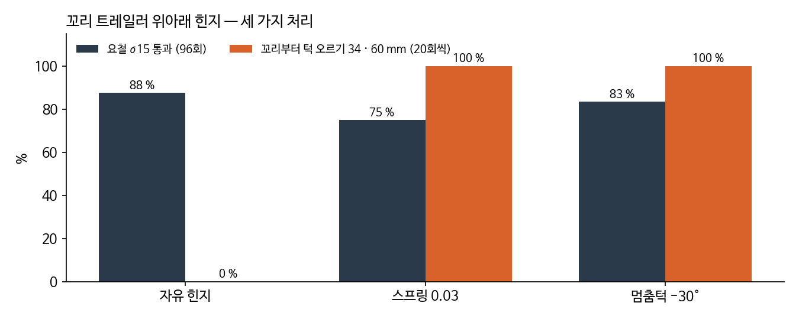

HW#4 피드백 1번은 "가는 쪽 조건을 오는 쪽에도"였다. 그래서 복귀 쪽 단차를 시험했는데, 꼬리부터 턱을 오를 때 꼬리 트레일러가 처져서 턱에 박혔다. 이 글은 그 문제를 고친 기록이다.

## 복귀 조건

들어갈 때 턱을 올라갔다면 돌아올 때는 꼬리부터 내려가야 한다. 반대로 들어갈 때 내려갔다면 돌아올 때는 꼬리부터 올라가야 한다. 복귀 개념은 다음과 같이 정했다.

- 짧은 복귀: 로봇이 스스로 후진 (파동 위상 반전)
- 긴 복귀: 지상 릴이 테더를 감아 회수
- 막히면: 비상으로 당김

바퀴를 r28로 키운 뒤 후진을 다시 확인했다. 직선 후진, 굴절 뒤 복귀, 꼬리부터 턱 내려가기는 그대로 통과했다. 새로 시험한 꼬리부터 턱 오르기만 통과하지 못했다.

## 원인



꼬리 트레일러의 바퀴는 힌지 바로 뒤에 있고(⑤편에서 정한 배치), 무게중심은 그보다 더 뒤에 있다. 그래서 꼬리 링크를 들면 트레일러가 바퀴를 축으로 기울면서 뒤끝이 내려간다(−63°). 20회씩 돌려 보니 20mm 4/20, 34mm 0/20, 60mm 0/20이었다.

## 스프링

처음에는 위아래 힌지에 가운데로 당기는 약한 스프링(0.03N·m/rad)을 달았다. 트레일러 자기 무게 모멘트(약 0.010N·m)의 3배라 트레일러가 꼬리 링크와 같이 들린다. 꼬리부터 오르기는 8/8이 되었다. 대신 요철 σ15가 12회 중 9회에서 7회로 떨어지는 경향이 있었다. 12회라 오차일 수도 있다고 보고 그때는 넘어갔다.

하지만 이 결정을 ②편의 AHP로 다시 보면, 중요도 0.231(좁은 공간 진입)을 내주고 0.074(끼임 시 회수)를 얻은 것이었다. AHP 순서와 반대인 맞바꿈이라 시드를 96개로 늘려 다시 확인했다. 요철 σ15 통과는 자유일 때 84/96(88%), 스프링 0.03일 때 72/96(75%)였다.

같은 시드끼리 짝지어 보면 자유만 통과한 경우가 18번, 스프링만 통과한 경우가 6번이었다(부호검정 p = 0.023). 스프링 쪽 손해는 실제로 있는 것이었다. 스프링 실패의 절반 이상은 머리가 지형을 다 지났는데 꼬리 트레일러가 마지막 블록에 걸린 경우였다.

## 멈춤턱

꼬리부터 오르기에서 문제는 트레일러가 아래로 처지는 것 하나뿐이다. 하지만 가운데로 당기는 스프링은 위로든 아래로든 항상 버티기 때문에 요철에서 지형을 따라가지 못한다. 그래서 아래쪽 30°에만 멈춤턱(꼬리 링크 끝판의 출력물 돌기)을 두고, 그 안쪽(−30~+60°)은 자유로 두었다.



_요철 σ15(96회)와 꼬리부터 턱 오르기 34, 60mm(20회씩). 멈춤턱은 오르기를 지키면서 요철 손해가 거의 없다_

| 시험 | 멈춤턱 −30° | 자유 | 스프링 0.03 |
|---|---|---|---|
| 꼬리부터 오르기 20, 34, 60mm | 20/20, 20/20, 20/20 | 4/20, 0/20, 0/20 | 20/20, 20/20, 20/20 |
| 같음, 릴 장력 없이 (34, 60) | 10/10, 10/10 | - | 10/10, 10/10 |
| 꼬리부터 내려가기 20, 34, 60mm | 각 20/20 | 12/12 | - |
| 요철 σ15 (96회) | 83% | 88% | 75% |
| 전진 단차 14조건, 60mm | 140/140, 10/10 | 140/140, 10/10 | 140/140, 10/10 |
| 직선 후진, 굴절 복귀, 오르막 15° | 자유와 숫자까지 같음 | | |

멈춤턱과 자유의 요철 차이는 의미가 없었다(p = 0.45). 평지, 후진, 경사에서는 트레일러가 30°까지 처질 일이 없다. 멈춤턱이 아예 닿지 않으니 숫자까지 같게 나온다.

"진짜로?"라는 질문을 받고 세 가지를 다시 확인했다. 우선 멈춤턱 설정이 각 시험 모델에 정말 들어갔는지 보았다. 시뮬레이션 모델 XML을 하나씩 열어서 힌지 범위가 −30~60인 것을 확인했다. 다음으로 막는 장치가 애초에 필요한지 보려고 자유 힌지를 20회씩 돌렸다(위 표). 마지막으로 보지 않은 장면이 있는지 따져 보았는데, 하나가 있었다.

## 머리부터 턱 내려가기

지금까지 단차는 전진 오르기, 그 복귀인 꼬리부터 내려가기, 그리고 꼬리부터 오르기만 보았다. 들어가는 길에 머리부터 턱을 내려가는 경우는 어떤 설계로도 돌려 본 적이 없었다. 이때는 꼬리 링크가 모서리를 넘으면서 숙여지고 트레일러는 아직 턱 위에 남는다. 멈춤턱이 닿을 수 있는 상황이다.

단순한 제어(파동과 구동 바퀴, 피치는 0°를 향해 부드럽게)로 돌려 보니 20, 34mm는 5/5, 60mm는 0/5였다. 트레일러를 자유, 스프링, 멈춤턱 중 무엇으로 해도 결과가 같았다. 멈춤턱과는 상관없는 별개의 문제였다.



원인은 바퀴 없는 요 모듈이 모서리에 배를 걸치는 것이었다. 몸이 비스듬한 다리처럼 걸리고, 구동 바퀴(j7, j9 축)가 둘 다 공중에서 무부하 속도로 헛돈다.

해결 방법은 꼬리부터 오르기와 같다. 받침점(꼬리 링크 시작, 피치 관절 바퀴, 머리 바퀴)마다 바퀴가 아직 턱 위에 걸쳐 있으면 높이 h, 아니면 0을 목표로 둔다. 그리고 받침점 사이의 기울기 차를 피치 명령으로 준다.

처음에는 피치를 단단하게(kp 3.0) 잡았는데 34mm만 0/3이었다. 앞 3마디가 모서리 너머로 외팔보처럼 떠 버렸다. 강성과 미리 숙이는 거리를 조합해 보니, 부드럽게(kp 0.5) 잡아서 목표 모양으로 당기고 몸은 받침에 맡기는 쪽이 맞았다.



나쁜 조건 9가지에서 10회씩 돌린 결과는 아래와 같다.

| 조건 | 20mm | 34mm | 60mm | 75mm |
|---|---|---|---|---|
| 기본 (테더 0.35N, 바닥 μ 0.7) | 10/10 | 10/10 | 10/10 | 10/10 |
| 테더 0.65N | 10/10 | 9/10 | 10/10 | 5/10 |
| 바닥 μ 0.6/0.8 | 10/10, 10/10 | 10/10, 10/10 | 10/10, 10/10 | 10/10, 8/10 |
| 모서리를 2, 4cm 늦게 안다고 착각 | 10/10, 10/10 | 10/10, 10/10 | 10/10, 10/10 | 10/10, 10/10 |
| 모서리를 2, 4cm 일찍 안다고 착각 | 10/10, 10/10 | 9/10, 6/10 | 10/10, 10/10 | 0/10, 10/10 |
| 겹침 (테더 0.65, μ 0.6, +2cm) | 10/10 | 10/10 | 9/10 | 10/10 |

20mm(필수)는 90/90, 60mm(목표)는 89/90이다. 60mm에서 4번은 뒤집힌 채로 내려왔는데, 위아래가 대칭이라 거꾸로도 주행할 수 있다.

약점은 모서리를 실제보다 일찍 안다고 착각할 때다. 늦게 아는 쪽은 4cm까지 모두 통과했다. 실물에서는 머리가 떨어지는 것으로(머리 접촉 센서 이탈, 관절 전류, IMU) 모서리를 감지할 텐데, 감지는 항상 모서리를 지난 뒤에 된다. 그래서 오차는 늦게 아는 쪽으로 남고, 이는 유리한 쪽이다.

이 결과도 턱 위치 정답을 아는 이상적인 제어에서 나왔다. 감지와 추정을 넣은 실제 내려가기 동작은 2학기 제어 과제로 남겼다.

이 비교를 처음 돌릴 때 실수가 하나 있었다. 여러 시험을 한 줄씩 넘기는 셸 명령(`xargs -L`)이 줄 끝 공백 때문에 여러 줄을 한 명령으로 합쳐 버렸다. 파일 이름은 '자유 힌지'인데 실제로는 스프링이 들어간 결과가 나왔다. 결과 파일 첫 줄에 실제 설정을 찍게 해 둬서 바로 알아챘고, 그 결과는 버리고 다시 돌렸다.

다음 글: [⑧ 요구 추적과 관절 고장 시험]()
