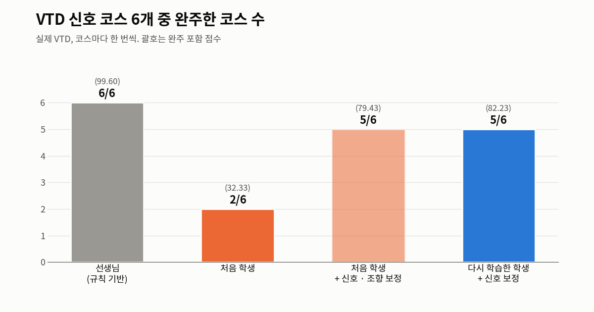
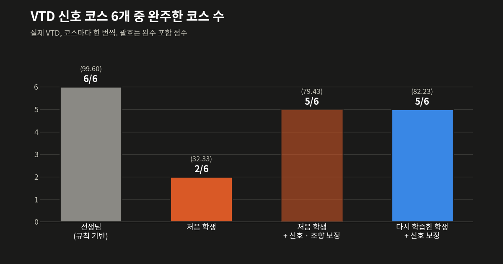
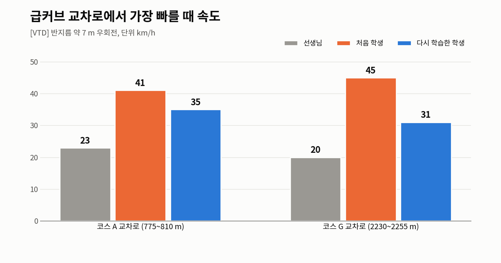
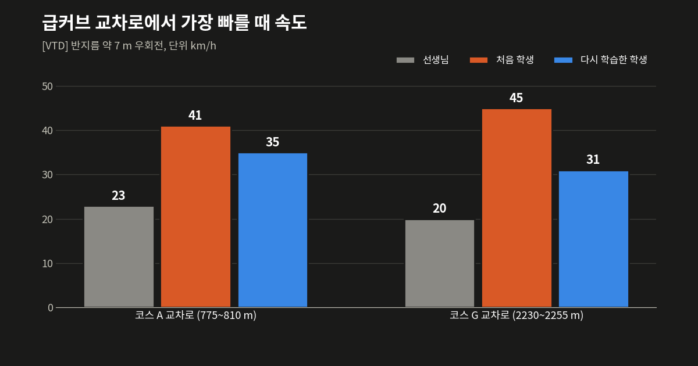

[⑤편]()에서 학생이 VTD에서 무너진 첫째 원인은 오프라인 차에 접지 한계가 없다는 점이었다. 이번에는 보상과 관측은 그대로 두고, 오프라인 차 물리에 언더스티어와 옆 가속도 한계만 넣어서 다시 학습해 보았다.

이 글에도 오프라인 숫자와 VTD 숫자가 섞여 있어서, 섞이는 곳에 [오프], [VTD]를 붙였다. VTD 결과는 코스마다 한 번씩만 잰 값이다.

## 차량 모델 수정

⑤편에서 VTD 차를 재 보니 같은 조향을 주어도 빠를수록 덜 돌았다. 실제 회전 비율이 3~6m/s에서는 0.84였는데 12~20m/s에서는 0.52로 떨어졌고, 이를 언더스티어 계수로 맞추면 K ≈ 0.016s²/m였다. 또한 반지름 6.7~7.3m 교차로를 40km/h로 돌려면 옆 가속도가 1.7~1.9g 필요하다. 실제 타이어로는 낼 수 없는 속도인데 오프라인 차는 그렇게 돌았고, 학생은 그 습관을 배웠다.

그래서 오프라인 차의 회전 계산에 두 가지를 넣었다. 하나는 언더스티어로, 요레이트를 `v·tan δ / (L + K·v²)`로 계산한다. K = 0.016이면 빠를수록 덜 돌게 된다. 다른 하나는 옆 가속도 한계로, 요레이트가 `a_max / v`를 넘지 못하게 자른다. 그 이상 꺾으면 차는 바깥으로 밀린다. a_max는 6m/s²로 두었다.

```python
# vtd_rl/world/dynamics.py — 둘 다 0 이면 예전 자전거 모형 그대로
    v = max(0.0, st.v + accel * dt)
    if p.understeer == 0.0 and p.lat_accel_max == 0.0:
        heading = st.heading + v / p.wheelbase * math.tan(steer) * dt
    else:
        yaw = v * math.tan(steer) / (p.wheelbase + p.understeer * v * v)
        if p.lat_accel_max > 0.0 and v > 0.1:
            lim = p.lat_accel_max / v
            yaw = _clamp(yaw, -lim, lim)
        heading = st.heading + yaw * dt
```

보상에는 손대지 않았다. 빨리 돌지 말라는 벌을 새로 주는 대신, 빨리 돌면 실제로 길 밖으로 밀리는 상황을 오프라인 환경에서 겪게 했다.

학습 전에는 고친 환경이 VTD의 실패를 재현하는지부터 확인했다. [오프] 고친 환경의 2단계 원본 시나리오 6개(시드 0)에서 선생님은 6/6 완주, 기존 학생은 0/6이었다. 학생은 6번 모두 7~87% 지점에서 도로를 벗어났다. VTD에서 보던 실패가 오프라인에서도 그대로 나온 것이다.

## 재학습과 선택

기존 학생을 출발점으로 두고, [③편]()의 KL 앵커도 같은 학생에 걸어서 이어 학습했다. 앵커 세기 0.03(칸 A)과 0.01(칸 B)에 시드 0~2로, 각각 100만 스텝씩 돌렸다.

고르는 순서는 미리 적어 두고 그대로 따랐다. 체크포인트 48개를 [오프] 96에피소드로 먼저 추렸는데, 상위 6개가 모두 칸 A였다. 앵커 0.01은 하나도 들지 못했다. 이 6개를 [오프] 큰 선택 윈도우 384에피소드로 다시 쟀다.

공식 정책으로 바꾸려면 [오프] 보고 윈도우에서 단계 ①과 ②가 100%, ③a와 ③b가 90% 이상이어야 한다고 미리 정해 두었다. 상위 후보 넷을 재 보니 통과한 정책은 없었다. 아래 표의 왼쪽 두 칸은 선택 윈도우 결과, 오른쪽 네 칸은 보고 윈도우 결과다(모두 [오프]).

| 체크포인트 | 완주 (384) | 완주 포함 점수 | ① | ② | ③a | ③b |
|---|---:|---:|---:|---:|---:|---:|
| A 시드 2 · 100만 | 347 | 86.06 | 83.3% | 94.4% | 84.7% | 84.7% |
| A 시드 2 · 50만 | 337 | 81.98 | 83.3% | 94.4% | 94.4% | 94.4% |
| A 시드 1 · 100만 | 321 | 79.84 | 83.3% | 83.3% | 86.1% | 77.8% |
| A 시드 2 · 37.5만 | 313 | 76.63 | 83.3% | 88.9% | 88.9% | 88.9% |
| A 시드 1 · 75만 | 271 | 66.42 | | | | |
| A 시드 0 · 75만 | 263 | 64.36 | | | | |

네 후보 모두 단계 ①에서 course_D를 놓쳤다. 1위 정책은 신호가 늘 녹색인 에피소드에서도 41~42% 지점에서 멈춰 섰는데, 원인은 아직 모른다. 처음 학생이 VTD에서 멈춰 서던 자리(41.4%)와 같은 곳이다.

정해 둔 규칙대로라면 오프라인에서 채택할 정책은 없다. 그래서 공식 정책은 바꾸지 않았고, 아래 VTD 결과는 큰 선택 윈도우 1위 정책(A 시드 2 · 100만)을 VTD에서 잰 기록이다.

## VTD 결과

⑤편과 같은 신호 코스 6개를 한 번씩 달렸다. VTD 신호의 ‘녹색 + 좌회전 화살표’(상태 5)는 오프라인에 없던 상태라 이번에도 녹색으로 읽는 어댑터를 켰다. 이 상태는 학습에는 아직 넣지 않았다. ⑤편에서 쓴 조향 보정은 끄고 달렸다.



{: .light }
{: .dark }
_처음 학생 + 보정은 ⑤편에서 다시 학습 없이 주행기에 신호 · 조향 어댑터만 붙인 결과_

| 코스 | 선생님 | 처음 학생 | 처음 학생 + 신호 · 조향 보정 | 다시 학습한 학생 + 신호 보정 |
|---|---|---|---|---|
| course_A | 완주 100.0 | 이탈 99.4 (38% 지점) | 이탈 98.2 (38% 지점) | 완주 99.4 |
| course_B | 완주 100.0 | 완주 98.2 | 완주 96.4 | 완주 99.4 |
| course_D | 완주 99.4 | 정체 97.6 (41% 지점) | 완주 95.8 | 완주 98.8 |
| course_E | 완주 99.4 | 완주 95.8 | 완주 94.0 | 정체 95.2 (72% 지점) |
| course_G | 완주 99.4 | 이탈 98.8 (66% 지점) | 완주 92.2 | 완주 97.0 |
| course_H | 완주 99.4 | 정체 96.4 (78% 지점) | 완주 98.2 | 완주 98.8 |
| 완주, 완주 포함 점수 | 6/6, 99.60 | 2/6, 32.33 | 5/6, 79.43 | 5/6, 82.23 |

다시 학습한 학생은 6번 모두 리스폰이 0이었다. 처음 학생에 어댑터를 덧댄 경우와 완주 수는 5/6으로 같지만, 조향 보정 없이 코스 A 교차로를 통과했고 완주 포함 점수도 82.23으로 79.43보다 높았다.

아래는 코스 B 하나를 처음부터 끝까지 달린 장면이다(4배속, 2.6km, 99.4점).



course_E에서는 109번 신호가 순수 녹색(상태 3)이었는데도 72% 지점에서 서 있다가 끝났다. 녹색 + 좌회전 문제는 아니고, 원인은 아직 확인하지 못했다.



## 교차로 속도



{: .light }
{: .dark }
_코스 A 775~810m, 코스 G 2230~2255m 구간 최고 속도_

VTD에서 급커브 교차로 최고 속도는 코스 A에서 41km/h가 35km/h로, 코스 G에서 45km/h가 31km/h로 내려왔다. 선생님(23, 20km/h)보다는 아직 빠르지만 VTD 차가 버티는 범위 안으로 들어왔다. 감속하라는 벌은 하나도 넣지 않았다. 오프라인 차가 실제 차처럼 밀리게 되자 학생이 스스로 속도를 줄인 것이다.

## 오프라인과 VTD 차이

같은 정책이 [오프] 합격 기준에서는 단계 ② 94.4%였는데, [VTD] 신호 코스는 5/6을 완주했다. 오프라인에 넣은 옆 가속도 한계 6m/s²와 빠른 속도의 언더스티어가 실제 VTD보다 크게 잡힌 것으로 보인다. 12~20m/s에서 K = 0.016 모델이 내는 회전 비율은 0.42인데, ⑤편에서 잰 VTD 실측은 0.52였다.

이번 결과는 VTD를 코스마다 한 번씩만 잰 것이고, 정지차와 대향차가 있는 시나리오는 다시 재지 않았다.

다만 코스 G 정지차 시나리오를 한 번 돌려 보기는 했다. 선생님은 속도를 줄인 뒤 옆 차로로 비켜 가는데, 다시 학습한 학생은 비키지 못하고 천천히 부딪쳤다. 점수는 재지 않았고, 정지차 비키기는 아직 남은 약점이다.



## 다음

우선 course_D 41% 지점과 course_E 109번 신호 앞에서 녹색인데도 서 있는 원인부터 확인할 생각이다. 그다음 a_max를 6에서 7~8m/s²로 올려 VTD에 더 가깝게 맞출 생각이다. 그러면 오프라인 합격 기준과 VTD 결과가 지금보다 잘 맞을 것으로 본다.

← [⑤편]() · 처음부터: [①편]()
