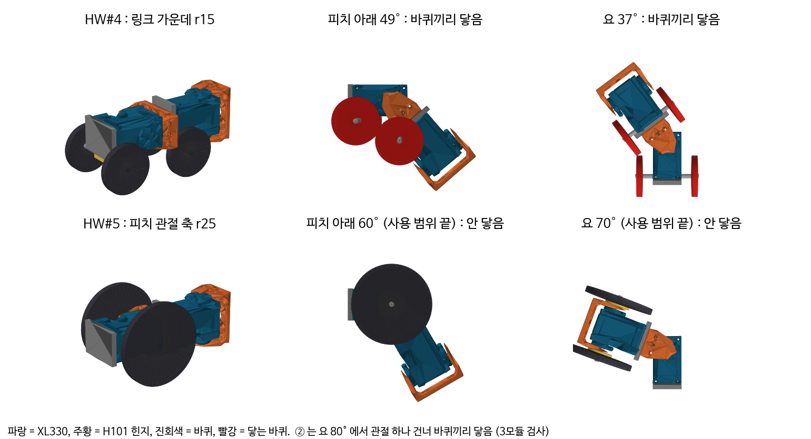
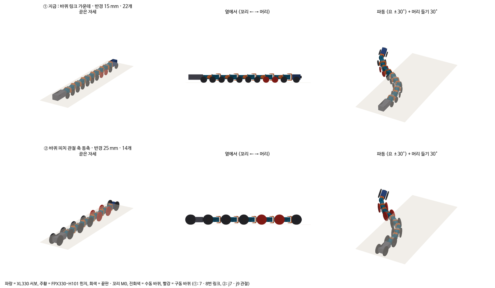
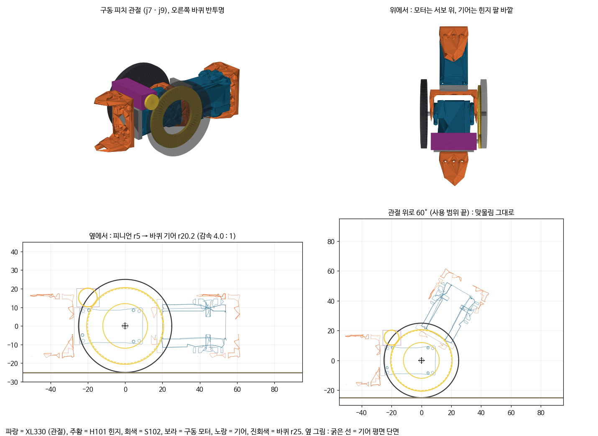
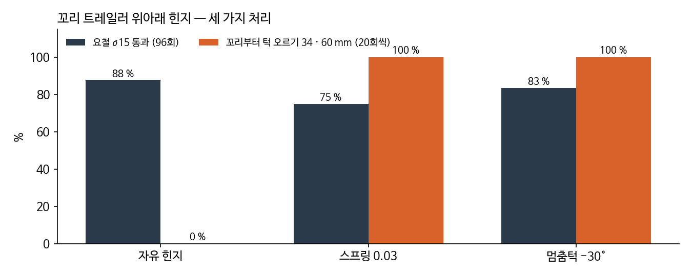
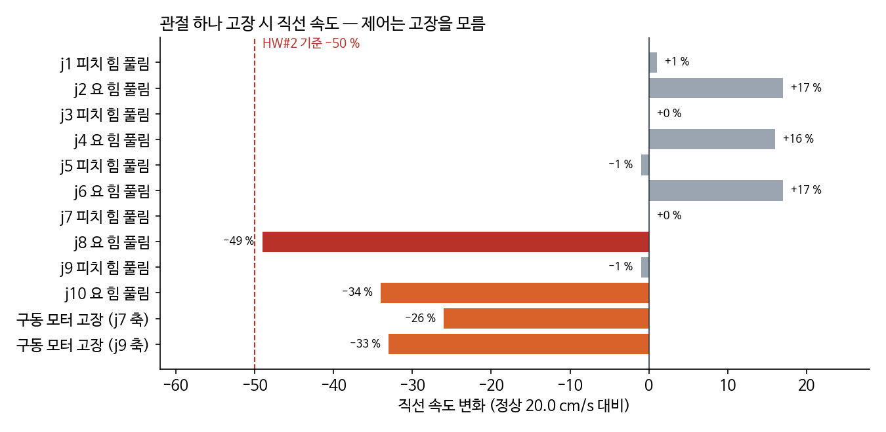
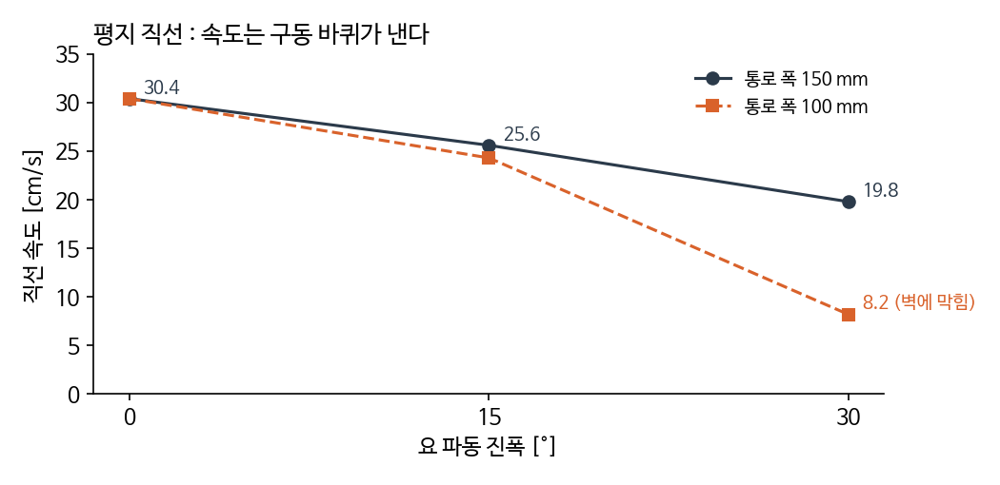

HW#5(기본 형상 II)는 HW#4에서 받은 지적에 답하는 과제였다. HW#4 발표 직후 관절 간섭부터 손대기 시작해서 오르막과 요철, 복귀, 요구 추적까지 차례로 정리했고, 10월 13일에 발표했다. 이 글은 그 네 가지를 한 편으로 묶은 것이다.

## 관절 간섭과 바퀴 배치

HW#4에서 가장 무게를 둔 지적은 관절이었다. 관절마다 간섭이 생기니 피치, 롤, 요 각각 간섭 없이 쓸 수 있는 범위를 형상에서 정하라는 것이었다. 답을 찾다 보니 바퀴 위치와 꼬리 상자까지 바뀌었다.

### 간섭 검사

HW#4 형상(바퀴가 링크 가운데, r15)을 실제 부품 STEP 파일(XL330 서보, FPX330 힌지)로 조립했다. 그리고 1°씩 꺾어 가며 충돌 검사(trimesh + fcl)를 돌렸다.

_위는 HW#4 배치로, 피치 아래 49°, 요 37°에서 바퀴끼리 닿는다. 아래는 피치 관절 동축 바퀴로, 사용 범위 끝에서도 닿지 않는다_

피치를 아래로 49° 꺾으면 앞뒤 바퀴가 닿는다. 60mm 턱 모서리를 넘을 때 필요한 각과 비슷한 값이다. 요는 37°에서 닿는데, 파동 30°에 조향을 더하면 금방 넘는 각이다.

### 바퀴 배치

그래서 바퀴를 피치 관절(j1, 3, 5, 7, 9)의 회전축과 같은 축에 달았다. 이렇게 하면 관절을 아무리 꺾어도 바퀴는 자기 축 둘레로 돌기만 하고 모양이 변하지 않는다. 피치 쪽에서는 바퀴끼리 닿는 문제가 사라졌다.

_① 링크 가운데 r15 × 22, ② 피치 관절 동축(여기서는 r25, 이후 r28로 변경). 빨강은 구동 바퀴_

모듈 길이와 단면, 꼬리 상자를 도면 치수로 맞춘 뒤 ①과 ②를 다시 비교했다. 단차 14조건(턱 20~40mm, 테더, 마찰, 턱 위치 추정 오차를 바꿔 10회씩)에서 ①은 137/140, ②는 140/140이었다. 60mm 턱(천장 150)에서는 ①이 9/10, ②가 10/10이었다. ②가 모든 시험에서 ①과 같거나 나았다.

### 관절 사용 범위

| 관절 | 하는 일 | 필요 (계산) | 간섭 한계 (실제 부품) | 사용 범위 |
|---|---|---|---|---|
| 피치 | 머리 들기, 턱 모서리, 몸 따라 들기 | 모서리 42°, 머리 들기 56~64° | 프레임 110°, 구동 모터 위 90° | ±60° |
| 요 | 파동 + 조향 | 30° + 조향 28.6° = 58.6° | 관절 하나 건너 바퀴끼리 (r28에서 71°) | ±65° |
| 롤 | - | - | - | 없음 (고정) |

피치 ±60°는 다음과 같이 정했다. 피치 범위를 묶어 놓고 단차 시험을 다시 돌려 보니 ±45°까지 줄여도 60mm를 넘었다. 머리 받침 바퀴가 턱 면에 밀려서 굴러 넘은 것이다. 묶지 않은 ±90°는 14조건 140/140, 60mm 10/10이었고, ±60°도 140/140, 10/10으로 같았다. ±45°는 가혹 조건만 돌려서 30/30, 60mm 10/10이었다.

하지만 시뮬레이션 밖의 오차(턱 모서리 모양, 마찰)가 있으므로 기하로 계산한 필요각까지 덮는 ±60°로 정했다. "많이 드는 게 꼭 좋은 건 아니다"라는 피드백에 대한 답이기도 하다.

롤은 고정했다. 관절 자리에 수동 롤(스토퍼 ±15, 30°, 스프링)을 넣어 비교해 보았는데 결과가 엇갈렸다. 한쪽만 올라간 경사로에서는 단단하게 제한한 롤이 나을 때가 있었다. 하지만 완전 자유 롤은 거의 매번 뒤집혔다(링크 가운데 바퀴 배치에서 24/24). 이후 요철 시험에 제한 롤(±15°)을 넣었을 때도 4번 모두 뒤집혔다. 이득이 분명하지 않아서 만들기 쉬운 롤 고정을 택했다.

요 간섭 한계는 처음에 잘못 적었다. 첫 간섭 검사는 관절 하나 양쪽의 두 모듈만 봐서 요 한계를 110°로 적었다. 관절 하나 건너 바퀴끼리(피치 A, 요 B, 피치 C의 3모듈) 닿는 경우를 놓친 것이다. 3모듈로 다시 검사하니 한계는 80°(r25)였다.

### 구동 바퀴 모터

구동 바퀴도 관절 축(j7, j9)에 있다. 관절 서보는 관절을 돌리는 데 쓰이므로 바퀴를 돌릴 모터가 따로 필요하다. 그리고 그 모터가 관절 꺾임을 막아서는 안 된다.

_소형 기어드 모터(N20 급)를 서보 위에 눕혀 바퀴 안쪽 기어(중심 = 관절 축)에 물린 구조. 감속 4:1, 관절을 60° 꺾어도 맞물림 거리는 그대로_

기어 중심이 관절 축이라 관절을 몇 도 꺾든 맞물림이 유지된다. 모터 윗면(+20.3mm)이 바퀴 윗끝보다 아래에 있어서 높이도 늘지 않는다. 필요 토크는 바퀴당 0.004N·m 정도라 N20 급이면 여유가 있다.

### 꼬리 상자 M0

꼬리에는 제어기와 강압기가 든 상자(M0, 70mm, 30g)가 붙는다. 처음에는 고정 상자였는데 문제가 두 가지 나왔다.

우선 좌우로 꺾이지 않으면 굴절이 막힌다. 위아래로만 꺾이는 M0로는 ①이 굴절 0/6이었고, 좌우 힌지를 더하자 6/6이 되었다.

하지만 좌우 힌지가 자유로우면 후진할 때 접힌다. 자동차 트레일러를 후진할 때와 같은 현상이다. 직선 후진 10s 동안 8~17cm밖에 가지 못했다.

| M0 좌우 힌지 | 직선 후진 10s | 굴절 뒤 복귀 |
|---|---|---|
| 자유 | 8~17cm | 4/4 |
| 후진 때만 서보로 곧게 | 102~154cm | 4/4 |
| 좌우 고정 | 140~167cm (대신 전진 지형 성능이 나빠짐) | 4/4 |
| 자유 + 지상 릴이 테더를 0.2N으로 당김 | 119~144cm | 4/4 |

릴은 복귀 개념(긴 복귀 때 테더 자동 회수)에 이미 들어 있어서 부품이 늘지 않는다. 그래서 좌우 힌지는 자유로 두고 후진할 때 릴 장력을 주기로 했다. 바퀴는 힌지 바로 뒤에 둬야 60mm를 넘었다(상자 가운데에 두면 0/10). 결국 꼬리 제어기 상자(M0)는 좌우로 꺾이는 트레일러가 되었다.

이 트레일러의 위아래 힌지는 처음에는 자유였다. 이 힌지가 복귀할 때 문제가 된 일은 아래 '복귀' 절에서 다룬다.

## 오르막과 요철

바퀴를 관절 축으로 옮긴 뒤, 아직 돌려 보지 않은 요구 조건들을 시험했다. 오르막 15°와 요철 σ15는 시뮬레이션에서도 미달이었다. 이 절은 그 두 가지를 메워 본 기록이다.

### 시험 결과

시험은 40s 전진으로 쟀다. 오르막 15°는 3회 모두 미끄러져 내려가서 −210~−226cm였다(10°는 통과). 요철 σ15는 6회 중 5회 막혔다. 나머지 조건은 통과했다. 내리막 15°는 +1322~+1359cm로 오히려 빨라서 속도 제어가 필요하고, 옆 기울기 15°는 350~353cm였다.

배치를 ①로 바꿔도 결과는 같았다. 배치와는 상관이 없고 견인과 걸음새의 문제였다.

### 오르막

우선 계산부터 했다.

- 필요한 힘 = 무게의 경사 성분 + 테더 끌림 = 3.81 × sin 15° + 0.35 = 1.34N
- 낼 수 있는 힘 = 구동 타이어 μ 0.7 × 구동 바퀴에 실린 하중(무게의 35%) ≈ 0.9N, 여기에 파동 추진(작음)

0.4N 정도가 모자란다. 구동 바퀴에 무게를 더 싣거나 마찰을 키울 필요가 있다.

그래서 자세를 바꿔 가며 구동 바퀴에 실리는 하중 몫을 재 보았다. 그대로 두면 35%다. 머리를 들면(j9 +20°) 머리 무게가 j9 구동 바퀴로 옮겨 가서 50%가 된다. j5 바퀴를 띄우면 42%, 둘 다 하면 57%였다.

| 자세 | 구동 타이어 μ | 바닥 μ | 테더 | 오르막 15°, 40s |
|---|---|---|---|---|
| 그대로 | 0.7 | 0.7 | 0.35N | −156~−171cm |
| 머리 들기 | 0.7 | 0.7 | 0.35N | +196~203cm |
| 머리 들기 | 0.6 | 0.6 | 0.65N | −150~−162cm |
| 머리 들기 | 0.9 | 0.6 | 0.65N | +136~137cm (나쁜 조건에서도 3/3) |

이 결과로 꼬리 IMU가 오르막을 감지하면 머리를 20° 드는 경사 모드를 넣었고, 구동 타이어는 μ ≥ 0.9로 정했다. 모드가 자동으로 바뀌므로 구조도 그대로이고 조작 입력도 늘지 않는다. 타이어 재질(O링)은 경사판 미끄럼 각(μ = tan θ)으로 실측해서 골랐다.

### 요철 시험 조건

처음 요철 시험은 로봇을 블록 위에 떨어뜨려서 시작했다. 하지만 4번 모두 바퀴가 블록 옆면에 낀 채로 출발해서 거의 움직이지 못했다. 그래서 평지에서 출발해 블록 지형으로 들어가도록 시험을 고쳤다. 그다음 두 가지를 따져 보았다.

첫째, 블록 지형은 턱이 이어진 지형이다. σ15에서는 앞 블록이 17mm(바퀴로 굴러 넘는 한계)보다 높게 솟은 곳이 21%다. 파동만 하는 제어로는 지형 입구의 첫 턱에서 멈춘다. 그래서 기구의 한계를 보려면 지형 높이를 안다고 가정하고, 피치로 몸을 지형에 맞추는 '정답' 제어를 넣을 필요가 있었다.

둘째, 좌우 높이차 때문에 로봇이 뒤집힌다. 뒤집힌 경우는 모두 완전히 거꾸로(180°)였다. 이 설계는 체인 축을 기준으로 위아래가 대칭이라 거꾸로도 똑같이 달린다(평지 40s에서 바로 633~639cm, 거꾸로 634~640cm). 그래서 뒤집히면 조향과 구동 부호만 바꾸면 된다.

시험 지형이 너무 가혹한지도 확인했다. 좌우 바퀴 자리(±21.5mm)의 높이차가 28mm(한쪽 바퀴 한계)를 넘는 비율을 보았다. 블록 σ15는 13.9%, 실제 잔해 바닥(공개 LiDAR 5구역)은 중앙값 15.8%였다. 실제 바닥이 조금 더 거칠다.

### 기구 비교

같은 제어(지형 맞춤, 뒤집히면 부호 전환)에 기구만 바꿔서 비교했다.

| 변형 | σ10 | σ15 |
|---|---|---|
| 바퀴 r25 (그때) | 1/4 | 0/4 |
| 바퀴 r28 | 4/4 | 4/4 |
| r30 (요 범위 ±60으로 축소 필요) | 4/4 | 3/4 |
| 서스펜션 ±10mm | 1/4 | 0/4 |
| 배 마찰 0.2 | 1/4 | 0/4 |
| r28 + 서스펜션 | 3/4 | 1/4 |

바퀴 반경 3mm 차이가 컸다. 바닥 틈이 7.7에서 10.7mm로, 굴러 넘는 턱이 약 17에서 19mm로 늘었다. 서스펜션은 오히려 결과가 나빠졌다. 스프링이 처지면서 바닥 틈이 줄어드는 것으로 보인다.

r28은 처음 4회에서 σ15 4/4였지만, 12회로 늘리자 9/12(75%)였다. 그 뒤로는 결론을 내기 전에 시행 수부터 늘렸다. 이후 96회로 늘렸을 때는 88%였다(아래 '복귀' 절).

### r28 변경

r25에서 r28로 바꾸면서 요 간섭 한계가 80°에서 71°로 줄었다. 그래서 요 사용 범위도 ±70°에서 ±65°로 좁혔다. 높이 × 폭은 50 × 47mm에서 56 × 47mm로 커졌고, 전도 한계각은 40.7°에서 37.5°로 낮아졌다.

다른 시험 결과는 그대로이거나 좋아졌다. 단차 14조건과 60mm는 r25가 140/140, 10/10, r28도 140/140, 10/10으로 같았다. 오르막 15° 나쁜 조건은 136cm에서 202~210cm로 늘었고, 굴절(요 ±65°)은 r28에서 6/6이었다.

### 판정

요철 σ15의 남은 부분은 기구보다 제어(턱 감지, 지형 맞춤 걸음새)의 몫이라고 판단했다. 위 결과는 지형을 아는 이상적인 제어에서 나온 것이고, 실제로는 2학기 제어(상태기계 M1, 학습 M2)가 지형을 알아내야 한다. 그래서 요구 충족 표에는 '부분 충족, 제어 과제'로 적었다.

## 복귀

HW#4에서는 복귀를 고려하지 않았다는 지적도 받았다. 갈 때의 조건을 올 때도 똑같이 줘야 한다는 것이었다. 그래서 복귀 쪽 단차를 시험했는데, 꼬리부터 턱을 오를 때 꼬리 트레일러가 처져서 턱에 박혔다. 이 절은 그 문제를 고친 기록이다.

### 복귀 조건

들어갈 때 턱을 올라갔다면 돌아올 때는 꼬리부터 내려가야 한다. 반대로 들어갈 때 내려갔다면 돌아올 때는 꼬리부터 올라가야 한다. 복귀 개념은 다음과 같이 정했다.

- 짧은 복귀: 로봇이 스스로 후진 (파동 위상 반전)
- 긴 복귀: 지상 릴이 테더를 감아 회수
- 막히면: 비상으로 당김

바퀴를 r28로 키운 뒤 후진을 다시 확인했다. 직선 후진, 굴절 뒤 복귀, 꼬리부터 턱 내려가기는 그대로 통과했다. 새로 시험한 꼬리부터 턱 오르기만 통과하지 못했다.

### 원인



꼬리 트레일러의 바퀴는 힌지 바로 뒤에 있고(앞에서 정한 배치), 무게중심은 그보다 더 뒤에 있다. 그래서 꼬리 링크를 들면 트레일러가 바퀴를 축으로 기울면서 뒤끝이 내려간다(−63°). 20회씩 돌려 보니 20mm 4/20, 34mm 0/20, 60mm 0/20이었다.

### 스프링

처음에는 위아래 힌지에 가운데로 당기는 약한 스프링(0.03N·m/rad)을 달았다. 트레일러 자기 무게 모멘트(약 0.010N·m)의 3배라 트레일러가 꼬리 링크와 같이 들린다. 꼬리부터 오르기는 8/8이 되었다. 대신 요철 σ15가 12회 중 9회에서 7회로 떨어지는 경향이 있었다. 12회라 오차일 수도 있다고 보고 그때는 넘어갔다.

하지만 이 결정을 ②편의 AHP로 다시 보면, 중요도 0.231(좁은 공간 진입)을 내주고 0.074(끼임 시 회수)를 얻은 것이었다. AHP 순서와 반대인 맞바꿈이라 시드를 96개로 늘려 다시 확인했다. 요철 σ15 통과는 자유일 때 84/96(88%), 스프링 0.03일 때 72/96(75%)였다.

같은 시드끼리 짝지어 보면 자유만 통과한 경우가 18번, 스프링만 통과한 경우가 6번이었다(부호검정 p = 0.023). 스프링 쪽 손해는 실제로 있는 것이었다. 스프링 실패의 절반 이상은 머리가 지형을 다 지났는데 꼬리 트레일러가 마지막 블록에 걸린 경우였다.

### 멈춤턱

꼬리부터 오르기에서 문제는 트레일러가 아래로 처지는 것 하나뿐이다. 하지만 가운데로 당기는 스프링은 위로든 아래로든 항상 버티기 때문에 요철에서 지형을 따라가지 못한다. 그래서 아래쪽 30°에만 멈춤턱(꼬리 링크 끝판의 출력물 돌기)을 두고, 그 안쪽(−30~+60°)은 자유로 두었다.



_요철 σ15(96회)와 꼬리부터 턱 오르기 34, 60mm(20회씩). 멈춤턱은 오르기를 지키면서 요철 손해가 거의 없다_

| 시험 | 멈춤턱 −30° | 자유 | 스프링 0.03 |
|---|---|---|---|
| 꼬리부터 오르기 20, 34, 60mm | 20/20, 20/20, 20/20 | 4/20, 0/20, 0/20 | 20/20, 20/20, 20/20 |
| 같음, 릴 장력 없이 (34, 60) | 10/10, 10/10 | - | 10/10, 10/10 |
| 꼬리부터 내려가기 20, 34, 60mm | 각 20/20 | 12/12 | - |
| 요철 σ15 (96회) | 83% | 88% | 75% |
| 전진 단차 14조건, 60mm | 140/140, 10/10 | 140/140, 10/10 | 140/140, 10/10 |
| 직선 후진, 굴절 복귀, 오르막 15° | 자유와 숫자까지 같음 | | |

멈춤턱과 자유의 요철 차이는 의미가 없었다(p = 0.45). 평지, 후진, 경사에서는 트레일러가 30°까지 처질 일이 없다. 멈춤턱이 아예 닿지 않으니 숫자까지 같게 나온다.

"진짜로?"라는 질문을 받고 세 가지를 다시 확인했다. 우선 멈춤턱 설정이 각 시험 모델에 정말 들어갔는지 보았다. 시뮬레이션 모델 XML을 하나씩 열어서 힌지 범위가 −30~60인 것을 확인했다. 다음으로 막는 장치가 애초에 필요한지 보려고 자유 힌지를 20회씩 돌렸다(위 표). 마지막으로 보지 않은 장면이 있는지 따져 보았는데, 하나가 있었다.

### 머리부터 턱 내려가기

지금까지 단차는 전진 오르기, 그 복귀인 꼬리부터 내려가기, 그리고 꼬리부터 오르기만 보았다. 들어가는 길에 머리부터 턱을 내려가는 경우는 어떤 설계로도 돌려 본 적이 없었다. 이때는 꼬리 링크가 모서리를 넘으면서 숙여지고 트레일러는 아직 턱 위에 남는다. 멈춤턱이 닿을 수 있는 상황이다.

단순한 제어(파동과 구동 바퀴, 피치는 0°를 향해 부드럽게)로 돌려 보니 20, 34mm는 5/5, 60mm는 0/5였다. 트레일러를 자유, 스프링, 멈춤턱 중 무엇으로 해도 결과가 같았다. 멈춤턱과는 상관없는 별개의 문제였다.



원인은 바퀴 없는 요 모듈이 모서리에 배를 걸치는 것이었다. 몸이 비스듬한 다리처럼 걸리고, 구동 바퀴(j7, j9 축)가 둘 다 공중에서 무부하 속도로 헛돈다.

해결 방법은 꼬리부터 오르기와 같다. 받침점(꼬리 링크 시작, 피치 관절 바퀴, 머리 바퀴)마다 바퀴가 아직 턱 위에 걸쳐 있으면 높이 h, 아니면 0을 목표로 둔다. 그리고 받침점 사이의 기울기 차를 피치 명령으로 준다.

처음에는 피치를 단단하게(kp 3.0) 잡았는데 34mm만 0/3이었다. 앞 3마디가 모서리 너머로 외팔보처럼 떠 버렸다. 강성과 미리 숙이는 거리를 조합해 보니, 부드럽게(kp 0.5) 잡아서 목표 모양으로 당기고 몸은 받침에 맡기는 쪽이 맞았다.



나쁜 조건 9가지에서 10회씩 돌린 결과는 아래와 같다.

| 조건 | 20mm | 34mm | 60mm | 75mm |
|---|---|---|---|---|
| 기본 (테더 0.35N, 바닥 μ 0.7) | 10/10 | 10/10 | 10/10 | 10/10 |
| 테더 0.65N | 10/10 | 9/10 | 10/10 | 5/10 |
| 바닥 μ 0.6/0.8 | 10/10, 10/10 | 10/10, 10/10 | 10/10, 10/10 | 10/10, 8/10 |
| 모서리를 2, 4cm 늦게 안다고 착각 | 10/10, 10/10 | 10/10, 10/10 | 10/10, 10/10 | 10/10, 10/10 |
| 모서리를 2, 4cm 일찍 안다고 착각 | 10/10, 10/10 | 9/10, 6/10 | 10/10, 10/10 | 0/10, 10/10 |
| 겹침 (테더 0.65, μ 0.6, +2cm) | 10/10 | 10/10 | 9/10 | 10/10 |

20mm(필수)는 90/90, 60mm(목표)는 89/90이다. 60mm에서 4번은 뒤집힌 채로 내려왔는데, 위아래가 대칭이라 거꾸로도 주행할 수 있다.

약점은 모서리를 실제보다 일찍 안다고 착각할 때다. 늦게 아는 쪽은 4cm까지 모두 통과했다. 실물에서는 머리가 떨어지는 것으로(머리 접촉 센서 이탈, 관절 전류, IMU) 모서리를 감지할 텐데, 감지는 항상 모서리를 지난 뒤에 된다. 그래서 오차는 늦게 아는 쪽으로 남고, 이는 유리한 쪽이다.

이 결과도 턱 위치 정답을 아는 이상적인 제어에서 나왔다. 감지와 추정을 넣은 실제 내려가기 동작은 2학기 제어 과제로 남겼다.

이 비교를 처음 돌릴 때 실수가 하나 있었다. 여러 시험을 한 줄씩 넘기는 셸 명령(`xargs -L`)이 줄 끝 공백 때문에 여러 줄을 한 명령으로 합쳐 버렸다. 파일 이름은 '자유 힌지'인데 실제로는 스프링이 들어간 결과가 나왔다. 결과 파일 첫 줄에 실제 설정을 찍게 해 둬서 바로 알아챘고, 그 결과는 버리고 다시 돌렸다.

## 요구 추적과 관절 고장 시험

V 프로세스로 진행하면서 바뀐 것이 많았다. 그래서 HW#2에서 만든 AHP, QFD와 어긋난 부분이 없는지 점검했다. 점검하다가 한 번도 돌리지 않은 요구(관절 고장 시 이동)를 찾아서 같이 시험했다.

### 요구 변경 이력

V 프로세스에서는 ① 요구사항 분석에서 정한 요구를 ⑨ 인수 시험에서 확인한다. 하지만 이 프로젝트는 HW#2와 HW#4 사이에 많은 것이 바뀌었다.

| 항목 | HW#2 | HW#3 | HW#4 (현재 기준) | 바뀐 이유 |
|---|---|---|---|---|
| 통로 폭 | 100mm | 120mm | 300 → 150mm, 인수 150 | 로봇 크기에서 거꾸로 계산한 값이었다. 실측 공극(30cm)에서 다시 뽑았다 |
| 굴절 | 90° × 4 | 반경 100 × 4 | 직각 × 4 | 반경 100은 통로 폭에서 나온 역산이었다. 붕괴 가옥 모사 경로로 바꿨다 |
| 단차 | 20mm | 20mm | 20 필수, 60 목표 | 국내 아파트 문턱, 욕실 턱 실측 |
| 요철, 경사 | 범위 밖 (평탄) | 0° | σ15, 15° | 재난 로봇이 험지에 약하면 안 된다는 지적과 잔해 스캔 |
| 진입 거리 | 3~5m | 3~5m | 요구 6m, 테더 5m라 미달로 명시 | Champlain 공극 6m 이상 안쪽 |
| 통신 | 3m 지점 영상 | - | 5m | 테더 길이 |

사용자 요구 7개(UR-1~7)는 HW#2 이후 그대로다. 그래서 AHP 가중치는 다시 계산할 이유가 없었다. 바뀐 것은 요구 아래의 기능 요구(18개에서 22개로)와 시험 조건이었다. 이 변화를 표 하나(요구 변경 이력)로 남기고, 시험 계획 문서도 HW#4 조건으로 고쳤다.

통로 폭이 100에서 150으로 바뀐 것은 시험이 쉬워지는 쪽의 변화다. 환경에서 다시 뽑은 값이긴 하지만, 같은 시기에 로봇 폭도 35에서 47mm로 커졌다. 지금 설계로 폭 100mm를 재 보니 직선은 파동을 줄이면 지나간다. 하지만 직각 굴절은 지금 제어로 0/6이다. 그래서 100mm 공극은 요구 범위 밖이라고 명시했다.

### QFD 열 점검

QFD의 열(설계 특성)은 관절 배치, 학습 제어, 헤드 카메라, 수동 바퀴, 모듈 폭, 테더였다. 지금은 '수동 바퀴'가 수동 바퀴와 구동 바퀴로 나뉘었고, 꼬리 IMU, 머리 접촉 센서, 꼬리 트레일러는 해당하는 열이 없다.

중요도 순서와 설계 진행 순서는 맞았다. 관절 배치가 1위였고, 실제로 가장 먼저, 가장 많이 다뤘다. 하지만 3위인 헤드 카메라는 설계가 가장 덜 되어 있었다.

### AHP 대조

| 결정 | 얻은 것 | 내준 것 | AHP로 보면 |
|---|---|---|---|
| 피치·요 교대 10관절 | 단차 (0/8 → 10/10) | 관절 +1 | 맞음 |
| 바퀴를 관절 축으로, r28 | 간섭 해소, 요철 0/4 → 9/12 | 높이 41 → 56mm | 맞음 |
| 경사 모드 (머리 들기) | 오르막 15° | - | 맞음, 자동이라 입력 2개 유지 |
| 트레일러 스프링 | 복귀 (0.074) | 진입 (0.231) | 반대. 멈춤턱으로 교체 (위 '복귀' 절) |

앞 글의 스프링 맞바꿈도 이 대조에서 찾은 것이다.

### 관절 고장 시험

HW#2 인수 기준 UR-7(중요도 4위)은 "관절 1개 힘 풀고 재주행, 직선 속도 저하 50% 이내"였다. 지금 설계로는 한 번도 돌린 적이 없는 시험이었다.

관절 10개 각각을 힘 풀림(서보 토크 off)과 0° 고정(굳은 서보, 또는 제어가 고장 관절을 곧게 두는 경우)으로 두고, 구동 바퀴 모터 2개는 바퀴 잠김으로 두어 22가지를 돌렸다. 기어드 모터는 역구동이 어려워서 바퀴 잠김으로 뒀고, 이것이 가장 나쁜 경우다. 제어는 고장을 모르는 상태로 돌렸다.

_직선(폭 150mm 통로, 25s, 3회) 속도 변화. 0° 고정 10가지는 −7~+15%라 그림에서 제외_

HW#2 기준으로는 22가지 모두 통과했다. 다만 j8(머리 바로 뒤 요) 힘 풀림은 −49%로 기준과 1% 차이였고, ㄱ자 굴절도 1/3만 성공했다. 실물에서는 기준을 맞추지 못할 수도 있다.

직선만 봐서는 보이지 않는 약점도 있었다. 20mm 턱의 단일 고장점은 머리 들기 관절 j9다(고장 시 0~1/5). 머리 쪽 구동 바퀴가 잠겨도 0~2/5다. 그래서 인수 시험 E1에서 단차도 같이 기록하도록 시험 계획에 넣었다. 나머지 관절은 하나가 고장 나도 굴절과 20mm 턱 결과가 정상과 같았다.

대응은 2학기 고장 대응 제어의 몫이다. 예를 들어 j9가 고장 나면 다음 피치 관절(j7)로 앞 4모듈을 드는 방식이 있다.

### 파동과 직선 속도

고장 결과에서 이상한 점이 하나 있었다. 요 관절 하나가 풀리면 오히려 빨라졌다(+17%). 그래서 파동 세기만 바꿔 가며 다시 쟀다.

_구동 바퀴만 쓰면 30.4cm/s(바퀴 무부하 속도), 파동 30°를 같이 하면 19.8cm/s_

평지 직선 속도는 구동 바퀴가 낸다. 파동은 굴절, 단차, 요철에서 역할을 한다. 구동 바퀴만으로도 요 오프셋으로 조향해서 ㄱ자 굴절은 3/3이었다. 피치 서보로 몸을 들고 구동 바퀴로 자동차처럼 가면 되지 않느냐는 HW#4 지적에 답할 때 이 결과를 쓸 수 있다. 평지 직선에서는 바퀴가 낫고, 관절은 다른 곳에서 필요하다.

처음 직선 시험은 통로를 5m로 만들었다. 하지만 빠른 경우에는 25s 안에 통로 끝을 빠져나가서, 빈 공간을 달린 숫자가 섞였다. 폭 100mm에서 파동 30°가 최고 속도로 나오는 이상한 결과를 보고 알아챘고, 통로를 10m로 늘려 다시 쟀다.

### 남은 항목

굴절 4회 연속 코스는 아직 ㄱ자 1회만 시뮬레이션으로 보았다. 진입 6m는 테더가 5m라 미달로 명시했고, 위치 ±15cm는 계산상 최악이 18cm다. 카메라(표적 판독, 교신)는 QFD 3위인데 아직 설계하지 않았고, 테더로 당겨 빼기는 시뮬레이션을 하지 않았다.

2학기 제어의 몫으로 남은 것은 요철 σ15(부분 충족), 머리부터 내려가기와 꼬리부터 오르기(지금은 이상적 제어로만 확인)의 감지 · 추정, 관절 고장 대응(j9, j8)이다. 이번 학기는 설계만 해서 실물로 해 본 것은 0건이다.

## 받은 피드백

10월 13일 발표 때 받은 지적이다.

- 위로 꺾인 통로와 뒤집혀서 가는 구간에서, 경사는 그렇다 쳐도 90°가 정말 되는지
- 처음보다 프로젝트가 많이 커졌다. 혼자 하기엔 양이 많으니 할 수 있는 범위를 다시 정할 것
- 바퀴마다 구동 모터를 다는 안은 쉽지 않아 보인다. 시험 시나리오에 넣지 않을 거라면 그걸 목표로 설계에 반영할수록 제약만 늘어난다
- 바퀴가 몸통보다 커야 해서, 피치 관절에 달더라도 실제로 만들면 관절 사이 간섭 같은 제약이 생길 수 있다
- 마이크는 지금 개념(마이크 하나, 멈춰서 듣기)이면 충분하다. 여러 지점에서 들은 소리를 이동 거리와 함께 쌓으면 위치를 좁힐 수 있으니 알고리즘으로 고민해 볼 것(꼭 넣으라는 뜻은 아니다)
- 테더 꼬임을 어떻게 막는지. 뒤쪽에 릴을 두고 풀면서 들어갔다가 감으면서 나오는 안이 나왔다

이틀 뒤(10월 15일) 따로 봐 주신 자리에서는 범위와 시나리오 쪽 지적이 이어졌다.

- 지형 판단에 라이다를 쓰는 방안과, 판단해야 할 최소한의 지형 조건을 정할 것
- 좌우 기울기에서 S자 파동을 치면 위쪽 무게 때문에 굴러떨어질 수 있다. 기울기를 감지하면 바퀴로 곧게 가는 것도 답이 될 수 있으니 지형마다 가장 좋은 기동을 생각할 것
- 유선이라 배터리 제약이 없어서, 평지에서도 구동 바퀴를 쓰면 '오르막에서만 바퀴 힘을 더 준다'는 차이가 없다. 오르막, 내리막을 빼거나 다른 기동을 찾을 것
- 일반 기동으로는 못 가는 지형을 먼저 보이고, 모드를 바꾸면 지나가는 것을 시뮬레이션으로 보일 것
- 시나리오는 직접 짜는 것이다. 지형과 기동을 표로 정리해 내 장비로 되는 대표 기동을 고르고, 그 기동으로 시나리오를 짤 것. 기본, 단차, 지형 하나, 꺾임 정도로 시나리오 4개면 충분하다
- 지형 자동 감지와 기동 효율 학습은 완전히 다른 방향이다. 기동 쪽이라면 모드 버튼은 사람이 눌러도 되고, 학습한 기동이 정해 둔 기동보다 전력과 속도에서 낫다는 것을 보이면 된다
- 대강이라도 처음부터 끝까지 도는 시스템을 먼저 만들고 고도화할 것. 평지, 요철, 꺾임, 단차 순의 단계별 시험 계획과 2학기 일정표를 낼 것
- 요구는 시나리오, 구간별 분할, 구간별 요구, 모듈 설계 순으로 뽑고, 요구마다 ID를 붙여 모듈 사양과 시험이 어느 요구에서 나왔는지 표시할 것

이 지적을 받고 다음 과제에서 시나리오와 범위를 다시 정했다.

← [④편]() · 처음부터: [①편]()
